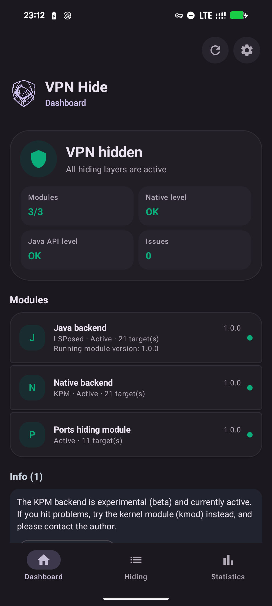
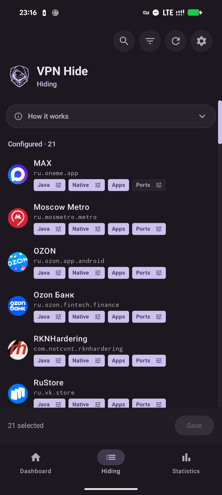
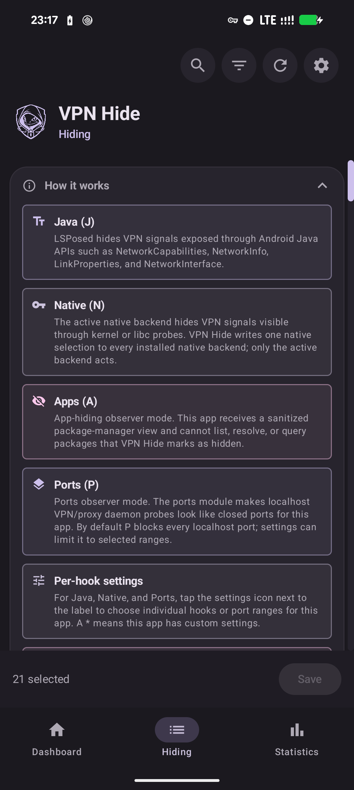
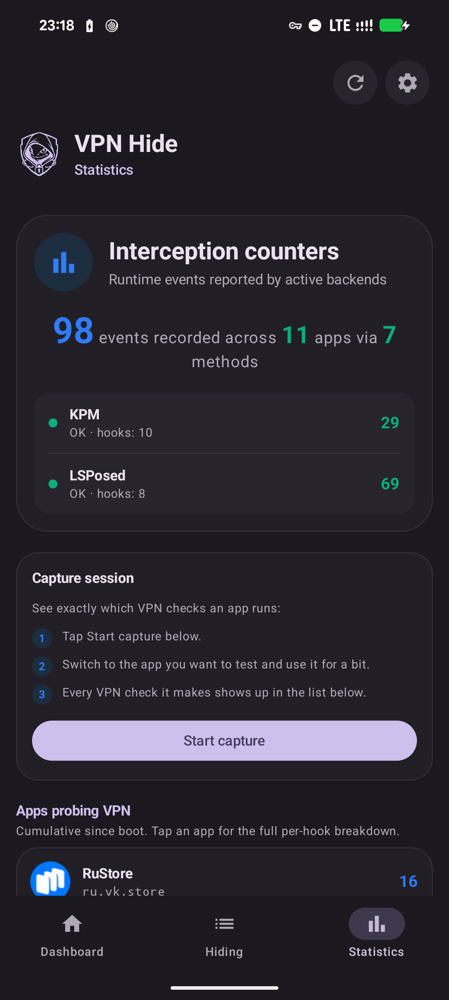
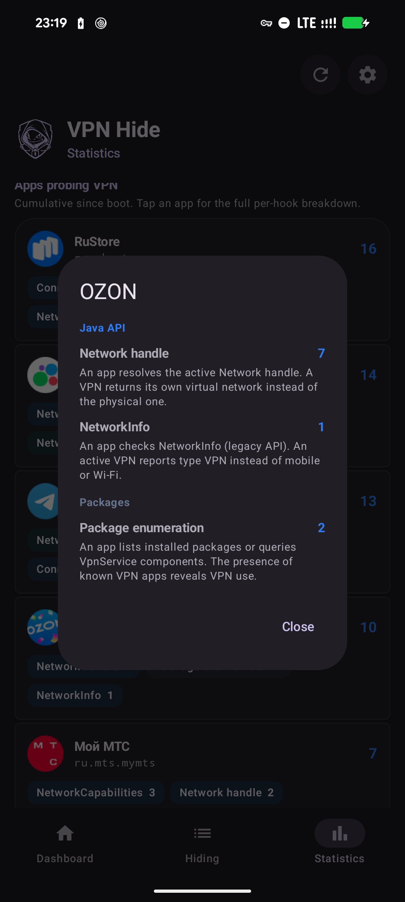
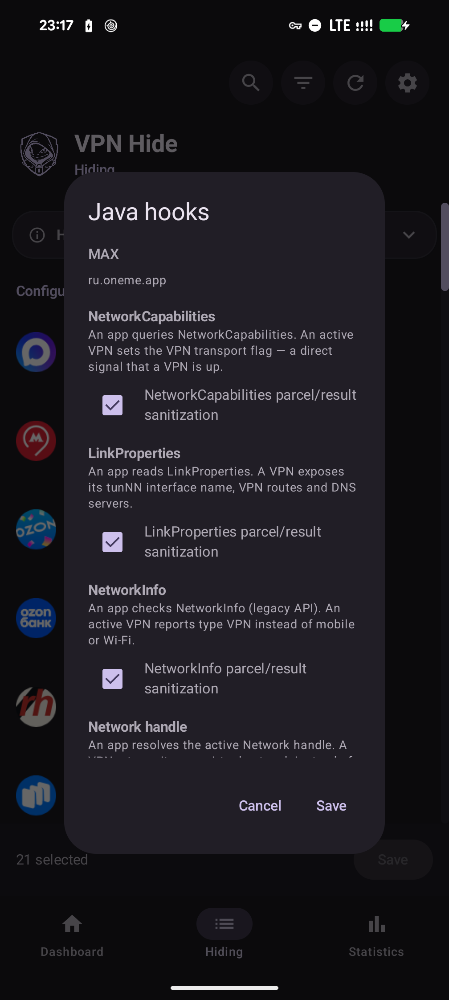
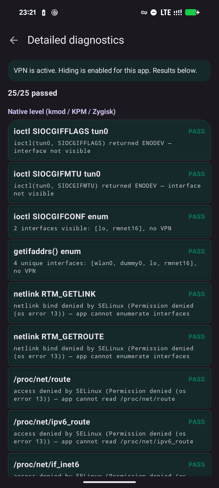
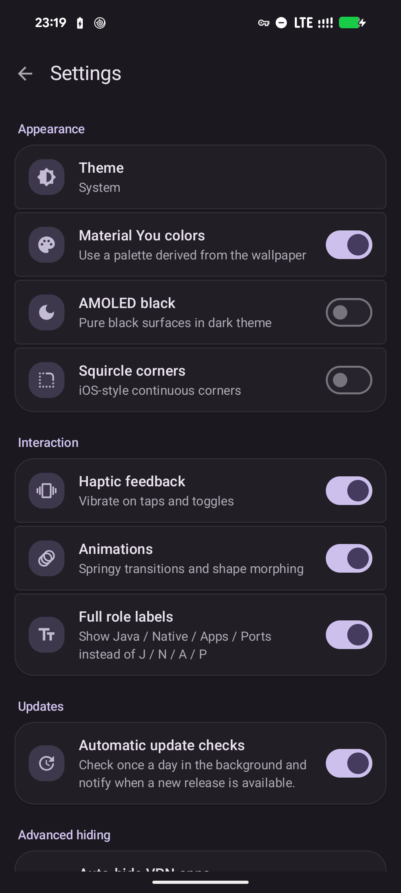
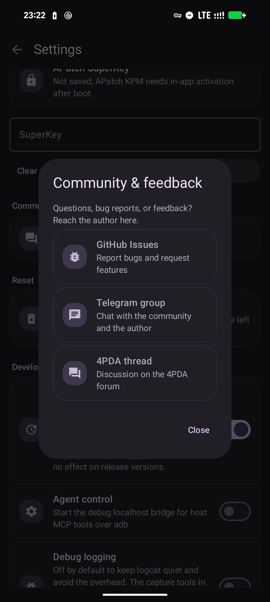

<p align="center">
  
</p>

<h1 align="center">VPN Hide</h1>

<p align="center">Скрывает активное VPN-соединение на Android от выбранных приложений.</p>

> **VPN Hide 2.0:** установите **`vpnhide.apk`** и один модуль **`vpnhide-core.zip`** из одной сборки. Core уже содержит payload kmod, KPM и обеих ABI Zygisk, сам выбирает и запускает подходящий backend, пишет конфигурацию и применяет Ports. Приложение работает через локальный сокет и не вызывает `su`. Отдельные ZIP бэкендов для установки не нужны.

> **Статус main:** переработка 2.0 ещё продолжается. Автоматическое обслуживание, расширенная автономная диагностика и приёмка на устройствах не завершены; фактическое состояние — в [roadmap](ROADMAP.md).


<p align="center">
  <a href="https://github.com/okhsunrog/vpnhide/actions/workflows/ci.yml"></a>
  <a href="https://github.com/okhsunrog/vpnhide/releases/latest"></a>
  <a href="https://github.com/okhsunrog/vpnhide/releases"></a>
  <a href="LICENSE"></a>
</p>

<p align="center"><strong><a href="README.en.md">English version</a> · <a href="README.zh.md">中文版</a></strong></p>

## Чем vpnhide лучше аналогов?

Существующие модули, такие как [NoVPNDetect](https://bitbucket.org/yuri-project/novpndetect) и [NoVPNDetect Enhanced](https://github.com/BlueCat300/NoVPNDetectEnhanced), покрывают только **Java API** обнаружение и хукают **внутри процесса** целевого приложения через Xposed. У этого подхода две критические проблемы:

1. **Обнаружение anti-tamper защитой** — любое приложение с проверкой инъекций в память обнаруживает хуки Xposed и отказывается работать. Автор NoVPNDetect Enhanced прямо пишет: *«Модуль не будет работать если у подключаемого приложения есть защита от LSPosed, проверка на инъекции в память. Например MirPay, Т-Банк.»*
2. **Нет нативного покрытия** — приложения, использующие C/C++ код, кроссплатформенные фреймворки (Flutter, React Native) или прямые системные вызовы, могут обнаружить VPN через `ioctl`, `getifaddrs`, netlink-сокеты и `/proc/net/*`. Java-хуки эти векторы полностью пропускают.

vpnhide решает обе проблемы многослойной архитектурой:

**Уровень 1 — Java API (модуль lsposed):** хукает `system_server`, а не целевое приложение. `NetworkCapabilities`, `NetworkInfo` и `LinkProperties` фильтруются на уровне Binder *до того*, как данные попадут в процесс приложения. Приложение получает чистые данные через IPC — никаких инъекций в его процесс, нечего обнаруживать. Этот же модуль скрывает выбранные приложения от приложений-наблюдателей на уровне `PackageManager` (роль Apps).

**Уровень 2 — нативный (kmod, встроенный в ядро, KPM или Zygisk):** покрывает нативные пути обнаружения. Активным должен быть ровно один Native-бэкенд:
- **kmod** (рекомендуется для поддерживаемых GKI-ядер) — хуки `kprobe`/`kretprobe` на уровне ядра. Фильтрует `ioctl`, `getifaddrs`/netlink-дампы интерфейсов, адресов, маршрутов и policy rules, а также отклоняет `SO_BINDTODEVICE` / `SO_BINDTOIFINDEX` для скрытых интерфейсов до изменения состояния сокета. Нулевой след в процессе приложения: никаких инъекций библиотек, нечего обнаруживать.
- **KPM** — KernelPatch Module с теми же 11 логическими kernel-хуками, но без привязки к GKI-варианту `.ko`. Полезен для старых/non-GKI ядер 4.9 / 4.14 / 4.19 / 5.4 и ситуаций, где `.ko` не может загрузиться. Требует KernelPatch runtime: APatch или [KPatch-Next-Module](https://github.com/KernelSU-Next/KPatch-Next-Module/releases/latest).
- **Zygisk** — запасной вариант, если kernel-level backend поставить нельзя. Inline-хуки `libc.so`, включая best-effort фильтрацию `setsockopt`, работают внутри процесса приложения и обходятся прямыми системными вызовами, поэтому банковские и anti-fraud приложения могут их обнаруживать. Для таких приложений лучше оставлять Native выключенным и полагаться на Java-уровень.

**Уровень 3 — Ports (часть модуля core):** через iptables блокирует выбранным приложениям доступ к `127.0.0.1` / `::1`, чтобы они не могли обнаружить локально запущенный VPN / proxy-демон по открытому порту (роль Ports). Правила применяет модуль core; отдельного модуля Ports в 2.0 нет.

Процесс целевого приложения полностью нетронут при использовании LSPosed + kernel-level Native-бэкенда (kmod или KPM) — ни Xposed, ни inline-хуков, ни модифицированных регионов памяти. Благодаря этому vpnhide работает с банковскими и государственными приложениями, которые активно обнаруживают и блокируют модули на основе Xposed.

## Что именно скрывает vpnhide

vpnhide скрывает от выбранных приложений три вещи — всё настраивается пер-апп через четыре роли **J / N / A / P** (Java, Native, Apps, Ports):

1. **Скрытие интерфейса** — главная задача. Убирает VPN-интерфейсы и маршруты из нативных API (`ioctl`, `getifaddrs`, netlink, `/proc/net/*`, `NetworkInterface`), не позволяет привязать сокет к скрытому интерфейсу и очищает Java API (`NetworkCapabilities`, `NetworkInfo`, `LinkProperties`). Его дают две роли сразу — **Java (J)** и **Native (N)**, они включаются независимо.
2. **Скрытие портов** — блокирует доступ к localhost для выбранных приложений, чтобы они не могли обнаружить Clash, sing-box, V2Ray, Happ и подобные инструменты через проверку локальных портов (роль **Ports (P)**).
3. **Скрытие приложений** — позволяет скрыть выбранные установленные приложения от выбранных приложений-наблюдателей. Полезно против проверок package visibility, например когда приложение пытается определить, установлен ли на устройстве VPN или proxy-клиент (роль **Apps (A)**).

## Какие модули мне нужны?

Для VPN Hide нужны **APK + единый Core ZIP**. Для Java-слоя дополнительно нужен LSPosed/Vector с модулем VPN Hide в scope **System Framework**. Ports входит в Core.

Core проверяет применимость backend: совместимый встроенный драйвер, подходящий bundled `.ko`, аутентифицированный KPM runtime, затем подходящий Zygisk loader. Несколько файлов payload внутри Core не являются конфликтом и не требуют выбора пользователя. Неподтверждённая совместимость или неизвестное состояние загрузки остаются явной причиной отказа, а не выбором наугад.

KernelPatch runtime для KPM и Zygisk loader — отдельные системные зависимости, когда выбранный путь их требует. Они не заменяются отдельным VPN Hide backend ZIP. Для [встроенного драйвера](builtin/README.md) отдельный модуль-бэкенд также не нужен, но Core остаётся необходимым.

## Установка

Эта инструкция относится к ветке 2.0. Берите APK и полный Core ZIP из одной сборки CI либо одного соответствующего релиза; не смешивайте их с пакетами старой схемы установки.

1. Установите `vpnhide.apk`, затем полный `vpnhide-core.zip` через Magisk / KernelSU / APatch.
2. Для Java включите модуль VPN Hide в LSPosed/Vector и добавьте **System Framework** в его scope. Перезагрузите устройство.
3. Откройте **Обзор**: состояние выбора, запуска и недостающих зависимостей сообщает Core. Вручную выбирать GKI и скачивать kmod/KPM/Zygisk ZIP не требуется.
4. Во вкладке **Скрытие** назначьте роли **J / N / A / P** приложениям, от которых нужно скрытие. Сохраните изменения. Для Zygisk перезапустите уже работавшие приложения-цели; новый процесс диагностики не доказывает обновление их hooks.

Старые отдельные модули учитываются при миграции и восстановлении. Сначала подготовьте проверенный полный replacement; не удаляйте рабочую установку заранее. Общий автоматизированный maintenance flow ещё доводится.

Конфигурацию `/data/system/vpnhide_config.json` пишет только Core через типизированные команды приложения/агента. Старые источники 0.x/1.x читаются изолированными адаптерами и сохраняются до подтверждённой миграции/архивации.

## Скриншоты

| Обзор — VPN скрыт | Скрытие — единый список | Как это работает |
|:-:|:-:|:-:|
|  |  |  |

| Статистика | Разбор по хукам | Выбор хуков для приложения |
|:-:|:-:|:-:|
|  |  |  |

| Диагностика | Настройки | Сообщество |
|:-:|:-:|:-:|
|  |  |  |

## Проверка

В приложении есть встроенная система диагностики, которая автоматически обнаруживает большинство проблем с настройкой.

**Обзор** (запускается при каждом открытии приложения):
- Статус модулей и бэкендов (установлен, активен, версия, количество целей)
- Валидация конфигурации LSPosed — читает базу данных LSPosed и проверяет, что VPN Hide включён, System Framework в scope, и нет лишних приложений в scope (частая ошибка при настройке)
- Обнаружение несоответствия версий — сравнивает версии установленных модулей с версией приложения и подсказывает, что именно нужно обновить
- Рекомендация Native-бэкенда — определяет ядро устройства и подбирает нужный файл kmod, KPM или Zygisk
- Проверка скрытия в реальном времени (при активном VPN) — выполняет 13 нативных и 12 Java API проверок, чтобы убедиться, что VPN действительно скрыт

Все обнаруженные проблемы показываются в виде карточек с конкретными инструкциями по исправлению.

**Статистика** — счётчики перехватов по каждому приложению: какие приложения и какими методами проверяют VPN.

**Настройки → Диагностика** — детальная разбивка по каждой проверке с индивидуальными результатами PASS/FAIL по всем 25 проверкам. Полезна для отладки, когда «Обзор» показывает неполное скрытие.

## Компоненты

| Директория | Что | Как |
|---|---|---|
| **[core/](core/)** + **[crates/](crates/)** | Модуль VPN Hide Core (Rust) | `vpnhide-core.zip`: root-демон, который однострочный `service.sh` запускает раз за загрузку. Он выбирает и загружает ровно один нативный бэкенд, доставляет ему конфиг, применяет iptables-правила Ports, обслуживает сокет приложения и выполняет его типизированную диагностику. |
| **[builtin/](builtin/)** | Встроенный в ядро бэкенд (C) | Тот же драйвер, что `.ko`, но вкомпилированный в ядро (`CONFIG_VPNHIDE=y`) — для ядер, где `.ko` не загрузить: интегрированные модули, нет kprobes, LTO. `scripts/integrate.py` вносит его в дерево ядра; модуль не нужен, core подхватывает его при загрузке. |
| **[kmod/](kmod/)** | Модуль ядра `.ko` + KPM backend (C) | Два kernel-level Native-бэкенда: стабильный GKI `.ko` на `kretprobe` и KPM на KernelPatch inline hooks. Оба дают нулевой след в процессе приложения; активным должен быть только один. ([подробнее](kmod/README.md), [KPM](kmod/kpm/README.md)) |
| **[lsposed/](lsposed/)** | LSPosed-модуль + приложение (Kotlin + Rust) | Хуки `writeToParcel` в `system_server` для per-UID фильтрации Binder. APK предоставляет обзорную панель (статус модулей, проверка версий, валидация конфигурации LSPosed, рекомендации по установке), вкладку «Скрытие» для ролей Java / Native / Apps / Ports и диагностику. ([подробнее](lsposed/README.md)) |
| **[zygisk/](zygisk/)** | Zygisk-модуль (Rust) | Inline-хуки `libc.so` в процессе приложения. Fallback, когда kernel-level backend недоступен. ([подробнее](zygisk/README.md)) |

## Покрытие обнаружения

| # | Вектор обнаружения | SELinux | kmod | KPM | Zygisk | LSPosed |
|---|---|---|---|---|---|---|
| 1 | `ioctl(SIOCGIFFLAGS)` на tun0 | | x | x | x | |
| 2 | `ioctl(SIOCGIFNAME)` разрешение индекса в имя | | x | x | x | |
| 3 | `ioctl(SIOCGIFMTU)` фингерпринтинг MTU | | x | x | x | |
| 4 | `ioctl(SIOCGIFCONF)` перечисление интерфейсов | | x | x | x | |
| 5 | Все остальные `SIOCGIF*` (INDEX, HWADDR, ADDR и т.д.) | | x | x | x | |
| 6 | `getifaddrs()` (использует netlink внутри) | | x | x | x | |
| 7 | netlink `RTM_GETLINK` дамп | | x | x | x | |
| 8 | netlink `RTM_GETADDR` дамп (IPv4 + IPv6) | | x | x | x | |
| 9 | netlink `RTM_GETROUTE` дамп | | x | x | x | |
| 10 | netlink `RTM_GETRULE` (policy rules) | | x | x | | |
| 11 | Публичный `/32` или `/128` host-route к VPN-серверу | | x | x | | |
| 12 | `SO_BINDTODEVICE` / `SO_BINDTOIFINDEX` | | x | x | libc | |
| 13 | `/proc/net/route` | блок. | x | x | x | |
| 14 | `/proc/net/ipv6_route` | блок. | x | x | x | |
| 15 | `/proc/net/if_inet6` | блок. | | | x | |
| 16 | `/proc/net/tcp`, `tcp6` | блок. | | | x | |
| 17 | `/proc/net/udp`, `udp6` | блок. | | | | |
| 18 | `/proc/net/dev` | блок. | | | | |
| 19 | `/proc/net/fib_trie` | блок. | | | | |
| 20 | `/sys/class/net/tun0/` и `/proc/sys/net/*/{conf,neigh}/tun0` | блок. | опц. | | | |
| 21 | `NetworkCapabilities` (hasTransport, NOT_VPN, transportInfo) | | | | | x |
| 22 | `NetworkInfo` (getType, getTypeName) | | | | | x |
| 23 | `ConnectivityManager.getActiveNetwork()` | | | | | x |
| 24 | `ConnectivityManager.getAllNetworks()` + VPN-сканирование | | | | | x |
| 25 | `LinkProperties` (interfaceName) | | | | | x |
| 26 | `LinkProperties` (маршруты через VPN-интерфейсы) | | | | | x |
| 27 | `NetworkInterface.getNetworkInterfaces()` | | x | x | x | |
| 28 | `/proc/net/route` через Java `FileInputStream` | блок. | x | x | x | |

**блок.** = на сток-enforcing сборках (Android 10+) SELinux обычно запрещает обычным приложениям доступ к этому файлу `/proc/net/*` / `/sys`. Но политика SELinux настроена **по-разному на разных устройствах и прошивках** (OEM- и кастомные ROM, `permissive`-сборки), поэтому защитой vpnhide следует считать только явно указанное в таблице покрытие.

**libc** = best-effort покрытие Zygisk: прямой системный вызов обходит inline-хук.

**опц.** = скрытие файловых путей в `.ko` по умолчанию выключено. Включите его
в настройках и перезагрузите устройство; в выключенном состоянии глобальные
VFS-хуки вообще не устанавливаются.

Важно: `ioctl` и netlink-дампы доступны обычному приложению без помощи SELinux; на Linux 5.7+ это относится и к первой привязке сокета к интерфейсу. Именно через netlink детекторы вроде RKNHardering обходят блокировку `/proc/net/route` (см. [issue #86](https://github.com/okhsunrog/vpnhide/issues/86)). Kernel-level варианты (kmod/KPM) закрывают отмеченные в таблице нативные пути без следа в процессе. Zygisk закрывает только вызовы, проходящие через libc; прямой raw syscall обходит его хуки. На более старых ядрах привязку непривилегированного сокета отклоняет само ядро. Остальное либо часто блокируется SELinux на стоке (но это зависит от устройства), либо идёт через Java API и покрывается LSPosed.

KPM реализует те же 11 логических kernel-хуков, что и `.ko`, но отдельные различия ABI и поведения на старых ядрах перечислены в полной карте векторов.

Полная карта векторов — с разбивкой по слоям, нюансами SELinux и известными пробелами — в [docs/detection-vectors.md](docs/detection-vectors.md).

## Сборка из исходников

Скрипты отдельных компонентов создают внутренние входы сборки. `core/build.py` даёт только daemon-base, даже если его локальный файл называется `vpnhide-core.zip`. Полный устанавливаемый пакет собирает `tools/vpnhide-tooling bundle assemble` из Core base, всех семи KMI, KPM и двух Zygisk ABI; CI публикует пользователю только полный Core, APK и подписанное описание пакета.

- **core**: `python3 core/build.py` — собирает `vpnhide-core` для arm64 + armv7 (cargo-ndk) в `core/target/vpnhide-core.zip`.
- **kmod**: `./kmod/build.py --kmi android14-6.1` (или `--all`) — авто-запускает DDK-контейнер через podman/docker. Подробнее: [kmod/BUILDING.md](kmod/BUILDING.md).
- **KPM**: `python3 kmod/kpm/build.py` — собирает универсальный `vpnhide-kpm.zip` через KernelPatch submodule. Подробнее: [kmod/kpm/README.md](kmod/kpm/README.md).
- **zygisk**: `cd zygisk && ./build.py` (Rust + NDK + cargo-ndk)
- **lsposed**: `cd lsposed && ./gradlew assembleDebug` (JDK 17 + Rust + NDK + cargo-ndk). Обычный debug APK остаётся debuggable, но проходит R8/shrink, чтобы не раздувать Xposed-модуль при установке и agent smoke-тестах. Для старой unminified debug-сборки используйте `./gradlew assembleRawDebug`.

### Заметки для контрибьюторов, застрявших на Windows

Если вы используете Windows, при сборке некоторых подпроектов возникают определенные неудобства.

**lsposed**: отлично собирается в Android Studio.


Для kmod и zygisk вам (к сожалению) потребуется установить [Docker for Windows](https://docs.docker.com/desktop/setup/install/windows-install/).

**kmod**: `python .\kmod\build.py --kmi android14-6.1` — скрипт сам подберёт docker и поднимет образ `ddk-min` (тот же, что в CI).

**KPM**: собирайте из Linux или WSL. Скрипт ожидает POSIX-инструменты, `make`/`clang`, KernelPatch submodule и Android NDK; нативная сборка на Windows сейчас не документирована.

**zygisk**:
```powershell
docker run --rm -it -v "${PWD}:/workspace" -v "vpnhide_cargo_cache:/usr/local/cargo/registry" -w /workspace ghcr.io/okhsunrog/vpnhide/ci:latest bash -c 'cd zygisk && python3 ./build.py'
```
Причина, по которой `zygisk` нельзя собрать напрямую, заключается в том, что исходный код зависимости `zygisk-api` содержит файл с именем `aux.rs`. Cargo использует `libgit2` для работы с git, в котором есть защита, запрещающая создавать файлы, _содержащие_ зарезервированные слова Windows. Вы получите ошибку: `cannot checkout to invalid path 'src/aux.rs'; class=Checkout (20)`. [Сообщают](https://superuser.com/a/1929659), что после какого-то обновления стало возможным создавать файлы, содержащие зарезервированные слова, **с** расширением, но, похоже, в `libgit2` это поведение не было изменено.

## Проверено на

- [RKNHardering](https://github.com/xtclovver/RKNHardering/) — все векторы обнаружения чисты
- [YourVPNDead](https://git.zapret.moe/zapretkvn/yourvpndead) ([зеркало на GitHub](https://github.com/zapret-discordyoutube/yourvpndead)) — все векторы обнаружения чисты

Оба реализуют официальную методику обнаружения VPN/прокси Минцифры РФ ([источник](https://t.me/ruitunion/893)).

## Раздельное туннелирование (split tunneling)

Корректно работает с конфигурациями VPN с раздельным туннелированием: затрагиваются только приложения из списка целей.

Настоятельно рекомендуется использовать split tunneling в паре с VPN Hide. VPN Hide прячет VPN на устройстве, но не может изменить то, что видит сервер: если приложение идёт через туннель, сервис видит выходной IP VPN-сервера и может отказать по нему. Поэтому приложения, которым туннель не нужен (банки, госуслуги, платёжные сервисы), лучше исключить из туннеля в настройках VPN-клиента — тогда они видят настоящий IP и никаких следов VPN. Подробнее: [Напрямую или через туннель](docs/help/ru/split-tunneling.md).

Приложения-детекторы, сравнивающие публичный IP устройства с внешними чекерами, лучше оставлять вне туннеля — их трафик должен выходить через оператора, а не через VPN.

## Модель угроз

Подробная [модель угроз](docs/threat-model.md): возможности атакующего приложения, доверенные компоненты, границы защиты и ограничения диагностики.

vpnhide скрывает активный VPN от конкретных приложений. Он НЕ предназначен для:
- Скрытия root или кастомной прошивки
- Обхода Play Integrity
- Обмана серверной детекции (утечки DNS, чёрные списки IP, фингерпринтинг латентности/TLS)

## Известные ограничения

- `kmod` требует поддерживаемое GKI-ядро с `CONFIG_KPROBES=y` (стандарт на устройствах Android 12+)
- KPM требует KernelPatch runtime (APatch или [KPatch-Next-Module](https://github.com/KernelSU-Next/KPatch-Next-Module/releases/latest)); не ставьте KPM одновременно с `.ko`
- `lsposed` требует LSPosed, LSPosed-Next или Vector
- `zygisk` собирается под arm64-v8a и armeabi-v7a (внедрение в 32-битные процессы); kernel-бэкенды — только arm64
- Прямые системные вызовы `svc #0` обходят хуки libc в Zygisk — для этого нужен kernel-level backend (kmod или KPM)
- До VPN Hide Core может достучаться только приложение (`dev.okhsunrog.vpnhide`), установленное в основном пользователе Android (user 0). Core создаёт свой сокет в каталоге данных именно этого приложения, поэтому копии во вторичном пользователе, рабочем профиле или пространстве клонов показывают экран «core недоступен». Управляйте всеми профилями из копии в основном пользователе
- Серверная детекция неисправима на стороне клиента — используйте раздельное туннелирование

## Поддержать проект

vpnhide бесплатный, без рекламы и телеметрии. Платных функций не будет — донат ничего не открывает.

Тот же список есть в приложении: **Настройки → Поддержать проект**, там адреса копируются по тапу.

**Boosty** — оплата картой, разово или подпиской: <https://boosty.to/okhsunrog/donate>

| Монета | Сеть | Адрес |
| --- | --- | --- |
| USDT | Tron (TRC20) | `TMskx2wKmPg11VYvHoS93vUQGm7yhcetUU` |
| BTC | Bitcoin | `bc1pmt9u6nux4x7n86zknwdgt9v02lah2tu6d983ak2prc5cwt8hsetq82ganh` |
| GRAM | The Open Network | `UQADYTtMBQdZvmNNEX02R9sACpdnXKlPV8RbuFrxo7JFBRGS` |
| LTC | Litecoin | `MBLKJfPNANH3U41UPJFtha7EPJGdbiW5dZ` |

## Лицензия

MIT. См. [LICENSE](LICENSE).

Модуль ядра объявляет `MODULE_LICENSE("GPL")`, как требуется ядром Linux для разрешения символов `EXPORT_SYMBOL_GPL` во время выполнения.

## Star History

<a href="https://www.star-history.com/?type=date&repos=okhsunrog%2Fvpnhide">
  <picture>
    <source media="(prefers-color-scheme: dark)" srcset="https://api.star-history.com/chart?repos=okhsunrog/vpnhide&type=date&theme=dark&legend=top-left&sealed_token=L6VLoQFGmusCfaI01irFbE2MJWoOX9V4Z66YMzG6z0vD-xjku8IZX4jnDHFYeAjjEne48AgxfoSExLa90tYlqeYq7E32T0DGbdKrR8UTyp0zVCfDeKGdCIku_20sKVi9WBuO4aqa3nBKDnKepezie3AC67kmr-2mazo76SIUyXWpRp8Lb038KZtafha8" />
    <source media="(prefers-color-scheme: light)" srcset="https://api.star-history.com/chart?repos=okhsunrog/vpnhide&type=date&legend=top-left&sealed_token=L6VLoQFGmusCfaI01irFbE2MJWoOX9V4Z66YMzG6z0vD-xjku8IZX4jnDHFYeAjjEne48AgxfoSExLa90tYlqeYq7E32T0DGbdKrR8UTyp0zVCfDeKGdCIku_20sKVi9WBuO4aqa3nBKDnKepezie3AC67kmr-2mazo76SIUyXWpRp8Lb038KZtafha8" />
    
  </picture>
</a>
