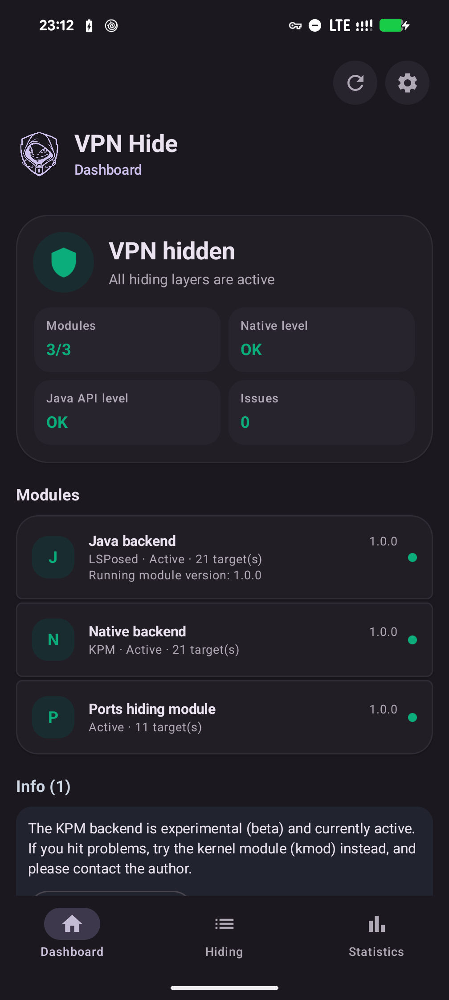
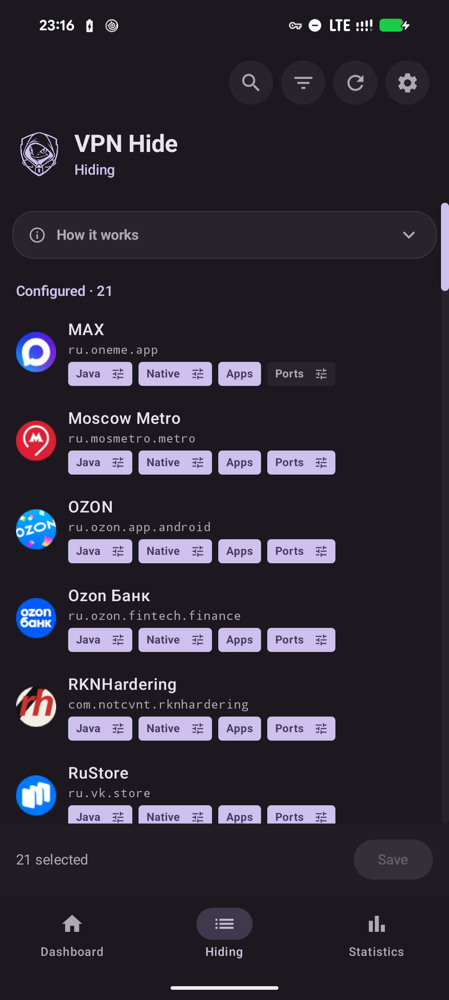
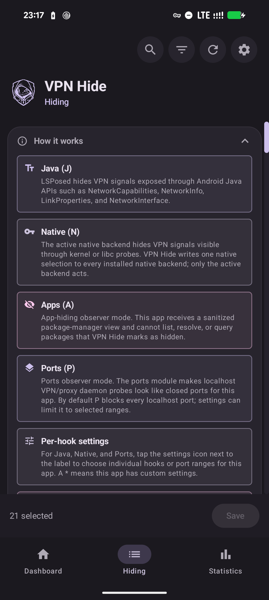
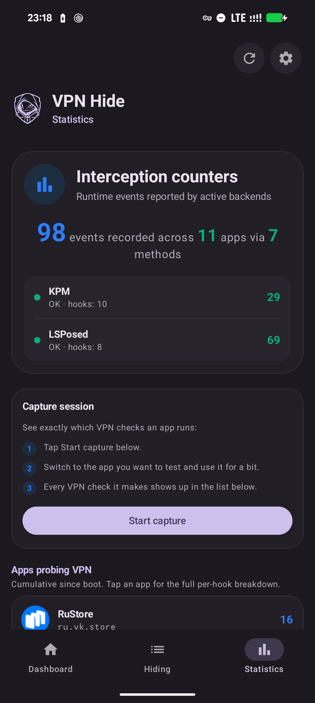
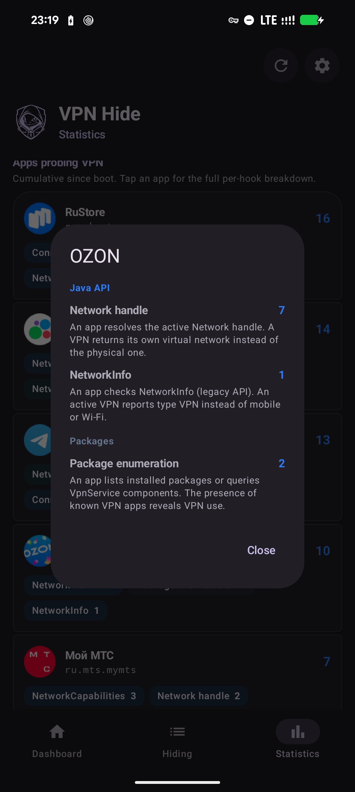
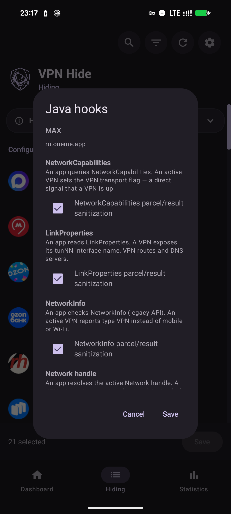
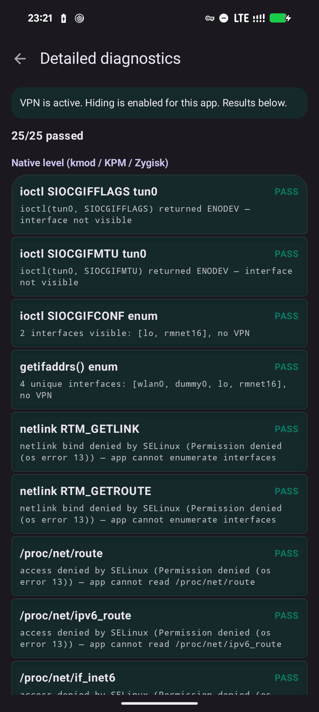
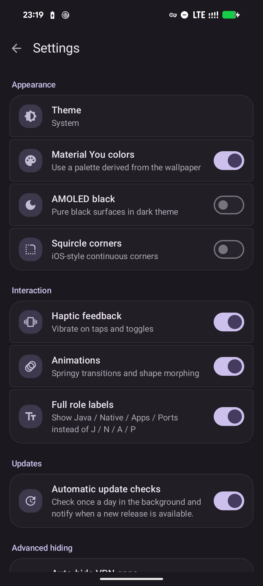
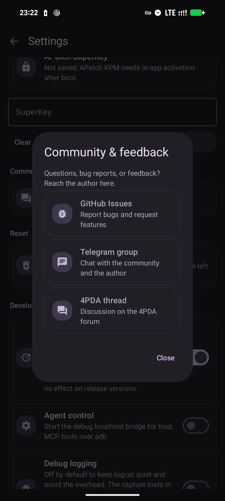

<p align="center">
  
</p>

<h1 align="center">VPN Hide</h1>

<p align="center">对选定应用隐藏活动的 Android VPN 连接。</p>

> **VPN Hide 2.0：**安装同一次构建的 **`vpnhide.apk`** 和一个 **`vpnhide-core.zip`**。Core 已包含 kmod/KPM payload 和两种 Zygisk ABI，负责选择并启动适用后端、写入配置和应用 Ports。应用仅使用本地套接字，不调用 `su`。无需单独安装后端 ZIP。

> **main 状态：**2.0 重构仍在进行。自动维护、扩展自主诊断和设备验收尚未完成，实际进度见 [implementation ledger](docs/notes/unified-core-implementation.md)。


<p align="center">
  <a href="https://github.com/okhsunrog/vpnhide/actions/workflows/ci.yml"></a>
  <a href="https://github.com/okhsunrog/vpnhide/releases/latest"></a>
  <a href="https://github.com/okhsunrog/vpnhide/releases"></a>
  <a href="LICENSE"></a>
</p>

<p align="center"><strong><a href="README.md">Русская версия</a> · <a href="README.en.md">English version</a></strong></p>

> 中文翻译由社区提供，欢迎母语者审阅与纠错。如发现措辞问题，欢迎在 [GitHub Issues](https://github.com/okhsunrog/vpnhide/issues) 反馈。

## 相比同类方案，vpnhide 好在哪？

现有模块，如 [NoVPNDetect](https://bitbucket.org/yuri-project/novpndetect) 和 [NoVPNDetect Enhanced](https://github.com/BlueCat300/NoVPNDetectEnhanced)，只覆盖 **Java API** 检测，并通过 Xposed 在**目标应用进程内部**挂钩。这种做法有两个致命问题：

1. **对防篡改不隐蔽** —— 任何带内存注入检测的应用都会发现 Xposed 钩子并拒绝工作。NoVPNDetect Enhanced 的作者明确表示：*“如果目标应用有 LSPosed 防护或内存注入检测，模块将无法工作。例如 MirPay、T-Bank。”*
2. **没有原生层覆盖** —— 使用 C/C++ 代码、跨平台框架（Flutter、React Native）或直接系统调用的应用，可以通过 `ioctl`、`getifaddrs`、netlink 套接字和 `/proc/net/*` 检测 VPN。这些向量被仅 Java 的钩子完全遗漏。

vpnhide 用分层架构同时解决这两个问题：

**第 1 层 —— Java API（lsposed 模块）：** 挂钩的是 `system_server`，而非目标应用。`NetworkCapabilities`、`NetworkInfo` 和 `LinkProperties` 在 Binder 层、在数据到达应用进程*之前*就被过滤。应用通过 IPC 收到干净的数据 —— 没有注入其进程，防篡改无从检测。同一模块还在 `PackageManager` 层对观察者应用隐藏选定应用（**Apps** 角色）。

**第 2 层 —— 原生（kmod、内核内置、KPM 或 Zygisk）：** 覆盖原生检测路径。同一时间应恰好有一个原生后端处于活动状态：
- **kmod**（推荐用于受支持的 GKI 内核）—— 内核级 `kprobe`/`kretprobe` 钩子。过滤 `ioctl`、`getifaddrs`/netlink 的接口、地址、路由和策略规则转储，并在套接字状态改变前对隐藏接口拒绝 `SO_BINDTODEVICE` / `SO_BINDTOIFINDEX`。在目标进程中零足迹：无库注入，无可检测之物。
- **KPM** —— 一个 KernelPatch 模块，实现与之相同的 11 个逻辑内核钩子，无需针对特定 GKI 变体的 `.ko`。适用于旧的/非 GKI 的 4.14 / 4.19 / 5.4 内核，以及 `.ko` 无法加载的情况。需要 KernelPatch 运行时：APatch 或 [KPatch-Next-Module](https://github.com/KernelSU-Next/KPatch-Next-Module/releases/latest)。
- **Zygisk** —— 当无法使用内核级后端时的回退方案。它的 `libc.so` 内联钩子包含尽力而为的 `setsockopt` 过滤，运行在目标进程内部，可被直接系统调用绕过，因此银行和反欺诈应用可能会检测到它。对于这类应用，请关闭原生并依赖 Java 层。

**第 3 层 —— Ports（核心模块的一部分）：** 阻止选定应用访问 `127.0.0.1` / `::1`（通过 iptables），使其无法通过本地绑定的 VPN / 代理守护进程的开放端口来检测它们（**Ports** 角色）。这些规则由核心模块应用；2.0 中没有单独的 Ports 模块。

使用 LSPosed + 内核级原生后端（kmod 或 KPM）时，目标应用的进程完全不受触碰 —— 没有 Xposed，没有内联钩子，没有被修改的内存区域。正因如此，vpnhide 能与主动检测并封锁基于 Xposed 模块的银行和政务类应用协同工作。

## vpnhide 隐藏什么

vpnhide 对选定应用隐藏三样东西，全部通过四个 **J / N / A / P** 角色（Java、Native、Apps、Ports）按应用配置：

1. **接口隐藏** —— 主要目标。它从原生 API（`ioctl`、`getifaddrs`、netlink、`/proc/net/*`、`NetworkInterface`）中移除 VPN 接口和路由，阻止将套接字绑定到隐藏接口，并净化 Java API（`NetworkCapabilities`、`NetworkInfo`、`LinkProperties`）。它由两个角色共同提供 —— **Java (J)** 与 **Native (N)** —— 可独立开关。
2. **端口隐藏** —— 为选定应用阻断本地回环访问，使其无法通过探测本地端口来检测 Clash、sing-box、V2Ray、Happ 等工具（**Ports (P)** 角色）。
3. **应用隐藏** —— 对选定的观察者应用隐藏选定的已安装应用。可用于对抗软件包可见性检查，例如某应用试图判断是否安装了 VPN 或代理客户端时（**Apps (A)** 角色）。

## 我需要哪些模块？

VPN Hide 需要 **APK + 一个统一 Core ZIP**。Java 层另需 LSPosed/Vector，并将 VPN Hide 的作用域设为 **System Framework**。Ports 已包含在 Core 中。

Core 按适用性检查：兼容的内置驱动、合适的 bundled `.ko`、经过认证的 KPM runtime、合适的 Zygisk loader。Core 中的多个 payload 是备选实现，不是安装冲突，也不需要用户选择。兼容性或加载状态未知时，会保留明确的拒绝原因。

所选路径需要时，KernelPatch runtime 和 Zygisk loader 是独立的系统依赖；它们不是单独的 VPN Hide 后端 ZIP。[内置驱动](builtin/README.md)也不需要配套后端模块，但仍需要 Core。

## 安装

本说明针对 2.0。APK 与完整 Core ZIP 必须来自同一次 CI 构建或同一对应发行版，不要混用旧安装模型的包。

1. 安装 `vpnhide.apk`，再通过 Magisk / KernelSU / APatch 安装完整的 `vpnhide-core.zip`。
2. 使用 Java 层时，在 LSPosed/Vector 启用 VPN Hide，将 **System Framework** 加入作用域，然后重启设备。
3. 打开**概览**，由 Core 报告后端选择、启动状态和缺少的依赖。无需手选 GKI，也无需下载单独的 kmod/KPM/Zygisk ZIP。
4. 在**隐藏**中为目标应用分配 **J / N / A / P** 角色并保存。使用 Zygisk 时重启已经运行的目标应用；新诊断进程的结果不能证明旧进程已更新 hooks。

旧独立模块只作为迁移和恢复的清单。先准备并验证完整 replacement，再清理旧安装；共同的自动维护流程仍在实现中。

只有 Core 通过应用/agent 的类型化命令写入 `/data/system/vpnhide_config.json`。0.x/1.x 来源由隔离适配器读取，在确认迁移/归档前保留。

## 截图

| 概览 —— VPN 已隐藏 | 隐藏 —— 单一应用列表 | 工作原理 |
|:-:|:-:|:-:|
|  |  |  |

| 统计 | 按钩子细分 | 按应用选择钩子 |
|:-:|:-:|:-:|
|  |  |  |

| 诊断 | 设置 | 社区 |
|:-:|:-:|:-:|
|  |  |  |

## 验证

应用内置诊断系统，可自动捕捉大多数配置问题。

**概览**（每次启动应用时运行）：
- 模块和后端状态（已安装、活动、版本、目标数量）
- LSPosed 配置校验 —— 读取 LSPosed 数据库，验证 VPN Hide 已启用、系统框架在作用域内，且没有多余应用被纳入作用域（一个常见的错误配置）
- 版本不匹配检测 —— 将已安装模块版本与运行中的应用版本对比，并明确告诉你需要更新什么
- 原生后端推荐 —— 检测你的内核并映射到正确的 kmod、KPM 或 Zygisk 产物
- 实时隐藏检查（当 VPN 活动时）—— 运行 13 项原生检查和 12 项 Java API 检查，验证 VPN 是否确实被隐藏

发现的任何问题都会以可操作的卡片形式显示，附带具体说明。

**统计** 标签页 —— 按应用细分哪些应用探测 VPN 以及如何探测，显示每个应用运行了哪些检查（由活动后端上报的计数）。

**设置 → 诊断**（详细诊断）—— 对全部 25 项检查逐项细分，给出各自的 PASS/FAIL 结果。当概览显示隐藏不完整时，可用于排查问题。

## 组成部分

| 目录 | 是什么 | 如何工作 |
|---|---|---|
| **[core/](core/)** + **[crates/](crates/)** | VPN Hide Core 模块（Rust） | `vpnhide-core.zip`：由一行 `service.sh` 在每次启动时拉起的 root 守护进程。它选择并加载恰好一个原生后端、向其下发配置、应用 Ports 的 iptables 规则、为应用提供套接字服务，并执行应用请求的类型化诊断。 |
| **[builtin/](builtin/)** | 内核内置后端（C） | 与 `.ko` 相同的驱动，但编译进内核（`CONFIG_VPNHIDE=y`），用于 `.ko` 无法加载的内核：集成模块、无 kprobes、LTO。`scripts/integrate.py` 将其引入内核源码树；无需模块，核心会在启动时接管它。 |
| **[kmod/](kmod/)** | `.ko` 内核模块 + KPM 后端（C） | 两个内核级原生后端：使用 `kretprobe` 的稳定 GKI `.ko`，以及使用 KernelPatch 内联钩子的 KPM。两者在目标应用进程中均零足迹；只应有一个处于活动状态。（[详情](kmod/README.md)，[KPM](kmod/kpm/README.md)） |
| **[lsposed/](lsposed/)** | LSPosed 模块 + 应用（Kotlin + Rust） | 在 `system_server` 中挂钩 `writeToParcel`，实现按 UID 的 Binder 过滤。APK 提供概览（模块状态、版本检查、LSPosed 配置校验、安装建议）、用于 Java / Native / Apps / Ports 角色的隐藏标签页，以及诊断。（[详情](lsposed/README.md)） |
| **[zygisk/](zygisk/)** | Zygisk 模块（Rust） | 在目标应用进程中内联挂钩 `libc.so`。当内核级后端不可用时的回退方案。（[详情](zygisk/README.md)） |

## 检测覆盖

| # | 检测向量 | SELinux | kmod | KPM | Zygisk | LSPosed |
|---|---|---|---|---|---|---|
| 1 | tun0 上的 `ioctl(SIOCGIFFLAGS)` | | x | x | x | |
| 2 | `ioctl(SIOCGIFNAME)` 由索引解析名称 | | x | x | x | |
| 3 | `ioctl(SIOCGIFMTU)` MTU 指纹 | | x | x | x | |
| 4 | `ioctl(SIOCGIFCONF)` 接口枚举 | | x | x | x | |
| 5 | 其他所有 `SIOCGIF*`（INDEX、HWADDR、ADDR 等） | | x | x | x | |
| 6 | `getifaddrs()`（内部使用 netlink） | | x | x | x | |
| 7 | netlink `RTM_GETLINK` 转储 | | x | x | x | |
| 8 | netlink `RTM_GETADDR` 转储（IPv4 + IPv6） | | x | x | x | |
| 9 | netlink `RTM_GETROUTE` 转储 | | x | x | x | |
| 10 | netlink `RTM_GETRULE` 策略规则 | | x | x | | |
| 11 | 指向 VPN 服务器的公网 `/32` 或 `/128` 主机路由 | | x | x | | |
| 12 | `SO_BINDTODEVICE` / `SO_BINDTOIFINDEX` | | x | x | libc | |
| 13 | `/proc/net/route` | 已阻断 | x | x | x | |
| 14 | `/proc/net/ipv6_route` | 已阻断 | x | x | x | |
| 15 | `/proc/net/if_inet6` | 已阻断 | | | x | |
| 16 | `/proc/net/tcp`、`tcp6` | 已阻断 | | | x | |
| 17 | `/proc/net/udp`、`udp6` | 已阻断 | | | | |
| 18 | `/proc/net/dev` | 已阻断 | | | | |
| 19 | `/proc/net/fib_trie` | 已阻断 | | | | |
| 20 | `/sys/class/net/tun0/` 及 `/proc/sys/net/*/{conf,neigh}/tun0` | 已阻断 | 可选启用 | | | |
| 21 | `NetworkCapabilities`（hasTransport、NOT_VPN、transportInfo） | | | | | x |
| 22 | `NetworkInfo`（getType、getTypeName） | | | | | x |
| 23 | `ConnectivityManager.getActiveNetwork()` | | | | | x |
| 24 | `ConnectivityManager.getAllNetworks()` + VPN 扫描 | | | | | x |
| 25 | `LinkProperties`（interfaceName） | | | | | x |
| 26 | `LinkProperties`（经 VPN 接口的路由） | | | | | x |
| 27 | `NetworkInterface.getNetworkInterfaces()` | | x | x | x | |
| 28 | 经 Java `FileInputStream` 读取 `/proc/net/route` | 已阻断 | x | x | x | |

**已阻断** = 在原厂 enforcing 构建（Android 10+）上，SELinux 通常会拒绝不受信任的应用访问该 `/proc/net/*` / `/sys` 文件。但**不同设备和 ROM 的 SELinux 策略配置各不相同**（OEM 和第三方 ROM、`permissive` 构建），因此只有表中明确标注的覆盖才应视为 vpnhide 的保护。

**libc** = Zygisk 的尽力而为覆盖：直接系统调用会绕过内联钩子。

**可选启用** = `.ko` 的文件系统隐藏功能默认关闭。请在设置中启用并重启；关闭时其全局 VFS 探测不会被安装。

重要：`ioctl` 和 netlink 转储对普通应用无需 SELinux 帮助即可使用；在 Linux 5.7+ 上，首次套接字接口绑定也是如此。这正是 RKNHardering 等检测器通过 netlink 绕过 `/proc/net/route` 拒绝的方式（见 [issue #86](https://github.com/okhsunrog/vpnhide/issues/86)）。内核级后端（kmod/KPM）覆盖上表标注的原生路径，且在目标进程中无足迹。Zygisk 仅覆盖经 libc 路由的调用；直接的原始系统调用会绕过其钩子。在较旧的内核上，内核本身会拒绝非特权的接口绑定。其余的要么在原厂上常被 SELinux 阻断（视设备而定），要么经由 Java API 并由 LSPosed 覆盖。

KPM 实现与 `.ko` 相同的 11 个逻辑内核钩子，而完整的向量图记录了在较旧内核上剩余的 ABI 与行为差异。

完整的向量图 —— 按层细分、SELinux 注意事项和已知缺口 —— 位于 [docs/detection-vectors.md](docs/detection-vectors.md)。

## 从源码构建

组件脚本只生成内部组装输入。`core/build.py` 仅生成 daemon base，即使本地文件名为 `vpnhide-core.zip`。完整安装包由 `scripts/payload_bundle.py` 将 base、七种 KMI、KPM 和两种 Zygisk ABI 组装而成。公开发行资产仅包含完整 Core、APK 和签名包描述。

- **core**：`python3 core/build.py` —— 用 cargo-ndk 为 arm64 + armv7 交叉编译 `vpnhide-core`，输出 `core/target/vpnhide-core.zip`。
- **kmod**：`./kmod/build.py --kmi android14-6.1`（或 `--all`）—— 通过 podman/docker 自动拉起 DDK 容器。完整指南：[kmod/BUILDING.md](kmod/BUILDING.md)。
- **KPM**：`python3 kmod/kpm/build.py` —— 通过 KernelPatch 子模块构建通用的 `vpnhide-kpm.zip`。详情：[kmod/kpm/README.md](kmod/kpm/README.md)。
- **zygisk**：`cd zygisk && ./build.py`（Rust + NDK + cargo-ndk）
- **lsposed**：`cd lsposed && ./gradlew assembleDebug`（JDK 17 + Rust + NDK + cargo-ndk）

### 给受困于 Windows 的贡献者的说明

如果你在 Windows 上，构建某些子项目会有一些不便。

**lsposed**：在 Android Studio 中可正常构建。


对于 kmod 和 zygisk，你（很遗憾地）需要安装 [Docker for Windows](https://docs.docker.com/desktop/setup/install/windows-install/)。

**kmod**：`python .\kmod\build.py --kmi android14-6.1` —— 脚本会自动识别 Docker 并拉取与 CI 相同的 `ddk-min` 镜像。

**KPM**：请在 Linux 或 WSL 下构建。脚本需要 POSIX 工具、`make`/`clang`、KernelPatch 子模块和 Android NDK；未记录原生 Windows 构建路径。

**zygisk**：
```powershell
docker run --rm -it -v "${PWD}:/workspace" -v "vpnhide_cargo_cache:/usr/local/cargo/registry" -w /workspace ghcr.io/okhsunrog/vpnhide/ci:latest bash -c 'cd zygisk && python3 ./build.py'
```
`zygisk` 无法在 Windows 上直接构建的原因是：其 `zygisk-api` 依赖包含一个名为 `aux.rs` 的文件。Cargo 使用 `libgit2` 进行 git 操作，而 `libgit2` 拒绝创建名称*包含* Windows 保留设备名（`AUX`、`CON`、`NUL`……）的文件。你会得到：`cannot checkout to invalid path 'src/aux.rs'; class=Checkout (20)`。[有人报告](https://superuser.com/a/1929659)称，某次 Windows 更新使得可以创建**带扩展名**的、包含保留字的文件，但 `libgit2` 尚未更新以放宽该限制。

## 已验证对抗

- [RKNHardering](https://github.com/xtclovver/RKNHardering/) —— 所有检测向量均干净
- [YourVPNDead](https://git.zapret.moe/zapretkvn/yourvpndead) ([GitHub 镜像](https://github.com/zapret-discordyoutube/yourvpndead)) —— 所有检测向量均干净

两者均实现了俄罗斯数字发展部官方的 VPN/代理检测方法论（[来源](https://t.me/ruitunion/893)）。

## 分应用代理（Split tunneling）

可与分应用代理的 VPN 配置正确协同工作：仅目标列表中的应用会受影响。

强烈建议将分应用代理与 VPN Hide 一起使用。VPN Hide 在设备上隐藏 VPN，但无法改变服务器看到的内容：如果应用走隧道，服务看到的是 VPN 服务器的出口 IP，仅凭这一点就可能拒绝你。因此不需要隧道的应用（银行、政务、支付类应用）最好在 VPN 客户端里排除出隧道——这样它们看到的是你的真实 IP，配合 VPN Hide 也看不到任何 VPN 痕迹。详见[直连还是走隧道](docs/help/zh/split-tunneling.md)。

将设备上报的公网 IP 与外部检测器对比的检测类应用应留在隧道之外 —— 它们的流量应走运营商网络，而非 VPN。

## 威胁模型

vpnhide 对特定应用隐藏活动的 VPN。它并非为以下用途设计：
- 隐藏 Root 或第三方 ROM 的存在
- 绕过 Play Integrity
- 欺骗服务端检测（DNS 泄漏、IP 黑名单、延迟/TLS 指纹）

## 已知限制

- `kmod` 需要带 `CONFIG_KPROBES=y` 的受支持 GKI 内核（Android 12+ 设备上为标准配置）
- KPM 需要 KernelPatch 运行时（APatch 或 [KPatch-Next-Module](https://github.com/KernelSU-Next/KPatch-Next-Module/releases/latest)）；不要将 KPM 与 `.ko` 一起安装
- `lsposed` 需要 LSPosed、LSPosed-Next 或 Vector
- `zygisk` 提供 arm64-v8a 和 armeabi-v7a（注入 32 位进程）；内核级后端仅支持 arm64
- 直接的 `svc #0` 系统调用会绕过 Zygisk 的 libc 钩子 —— 为此请使用内核级后端（kmod 或 KPM）
- 只有安装在 Android 主用户（user 0）中的应用（`dev.okhsunrog.vpnhide`）才能连接 VPN Hide Core。Core 只在该应用的数据目录中创建套接字，因此安装在次要用户、工作资料或分身空间中的副本都会显示“无法连接 core”页面。请在主用户中的副本里管理所有资料
- 服务端检测在客户端无法解决 —— 请使用分应用代理

## 支持项目

vpnhide 免费，无广告、无遥测。不会有付费功能，捐赠不会解锁任何内容。

应用内的 **设置 → 支持项目** 中也有同样的列表，点按地址即可复制。

| 币种 | 网络 | 地址 |
| --- | --- | --- |
| USDT | Tron (TRC20) | `TMskx2wKmPg11VYvHoS93vUQGm7yhcetUU` |
| BTC | Bitcoin | `bc1pmt9u6nux4x7n86zknwdgt9v02lah2tu6d983ak2prc5cwt8hsetq82ganh` |
| GRAM | The Open Network | `UQADYTtMBQdZvmNNEX02R9sACpdnXKlPV8RbuFrxo7JFBRGS` |
| LTC | Litecoin | `MBLKJfPNANH3U41UPJFtha7EPJGdbiW5dZ` |

## 许可证

MIT。见 [LICENSE](LICENSE)。

内核模块声明了 `MODULE_LICENSE("GPL")`，这是 Linux 内核在运行时解析 `EXPORT_SYMBOL_GPL` 符号所要求的。

## Star 历史

<a href="https://www.star-history.com/?type=date&repos=okhsunrog%2Fvpnhide">
  <picture>
    <source media="(prefers-color-scheme: dark)" srcset="https://api.star-history.com/chart?repos=okhsunrog/vpnhide&type=date&theme=dark&legend=top-left&sealed_token=L6VLoQFGmusCfaI01irFbE2MJWoOX9V4Z66YMzG6z0vD-xjku8IZX4jnDHFYeAjjEne48AgxfoSExLa90tYlqeYq7E32T0DGbdKrR8UTyp0zVCfDeKGdCIku_20sKVi9WBuO4aqa3nBKDnKepezie3AC67kmr-2mazo76SIUyXWpRp8Lb038KZtafha8" />
    <source media="(prefers-color-scheme: light)" srcset="https://api.star-history.com/chart?repos=okhsunrog/vpnhide&type=date&legend=top-left&sealed_token=L6VLoQFGmusCfaI01irFbE2MJWoOX9V4Z66YMzG6z0vD-xjku8IZX4jnDHFYeAjjEne48AgxfoSExLa90tYlqeYq7E32T0DGbdKrR8UTyp0zVCfDeKGdCIku_20sKVi9WBuO4aqa3nBKDnKepezie3AC67kmr-2mazo76SIUyXWpRp8Lb038KZtafha8" />
    
  </picture>
</a>
