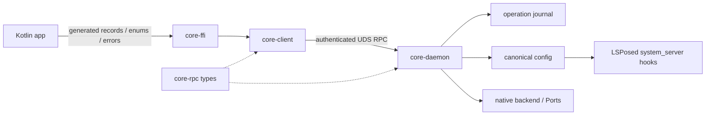

# Core architecture

Current implementation, app/core RPC32 and journal15 (reads1–14). Backend policy
implementation and publication of verified changes are approved under
[RFC0005](rfcs/0005-unified-backend-lifecycle-policy.md); remaining flows and device
gates are tracked separately. Kernel control-v2 / telemetry-v1 is unchanged.

## Owners and boundaries

| Owner | State and responsibilities |
|---|---|
| Core daemon | Durable canonical config, command plans and receipts, boot selection, backend delivery, Ports, root observations, debug leases and logcat recording |
| App process | Editor drafts, queued user intent, local preferences, navigation, app-context measurements and presentation |
| LSPosed hook in system_server | Direct canonical JSON reads, Java hooks and their telemetry |
| Native backend | Delivered policy, installed hooks and backend-specific runtime evidence |

Core is the ordinary privileged writer. It accepts fixed commands and bounded
probes, never arbitrary shell text. The APK has no root executable or `su` path.
The full Core ZIP contains passive backend payloads. Producer archives may have
installer shims, but no independent runtime activator; `activator` is a Core-side
library. Zygisk publication policy remains reopened under RFC0003.

The dependency path is `Kotlin → core-ffi → core-client → core-rpc`. Generated
UniFFI records, enums and errors carry config, edits, commands, publications,
refusals, receipts, leases, diagnostics and recording sessions. There is no JSON
request/reply facade at this boundary. The APK does not link the daemon, activator
or root probes. The unprivileged `native-policy` crate owns native mask/UID
projection and limits; both activator and local generated UniFFI picker preview
call it. `core-rpc::config_edit` similarly owns the pure canonical reducer,
field diff/write paths, conflict schema and candidate validation. Generated local
FFI previews reuse it; Kotlin retains UI drafts rather than a parallel reducer.
Core supplies the accepted inventory and selected-backend observation.
A local preview is not an admission receipt; Save and Agent mutations are checked
again against fresh Core inventory before any effect. JSON remains a storage/import/export format, diagnostic payload
content, private typed Rust probe inputs and tarpc's internal UDS serialization.

## Connection and app replica

One process-retained `CoreSession` owns one lazily connected, multiplexed tarpc
channel. Each new channel passes the version handshake. `core-client` fences
transport failures by connection generation; an older failed channel cannot
invalidate its replacement. It has no second watch-state mirror.

Kotlin long-polls `state_since(epoch, revision)` and feeds one publication reducer.
Connection generation, request success/failure ordering, epoch and publication
revision determine whether a response is current. Late replies cannot restore an
old epoch or clear a newer failure. Disconnect withdraws current evidence while
last-good display data may remain. Reconnection retries reads, never mutations.

Config revision changes with canonical state; publication revision also covers
observations and progress. Observations therefore do not create editor conflicts.
Heavy root snapshots provide explicit inventory/counters/forensic details; config,
boot selection and runtime read models come from the shared typed publication.

Standalone read-only root snapshots have one active and one pending admission
slot, separate from forensic exports. A competing normal startup/inventory read
waits within its RPC deadline and the shared snapshot runtime cap, preserving its
exact `packages` request. Cancellation before execution prevents a late child;
after execution starts, actual completion owns the permit. Overflow, expiry and
real probe failures remain failures. This does not retry destructive diagnostic
batches or manufacture startup readiness.

Root and config inputs join only after the app coordinator accepted at least the
root snapshot's core sequence, with matching core epoch and config revision. A
new epoch reusing a config revision cannot silently borrow old config provenance.

The production socket is in the release app's user-0 device-encrypted data dir.
DAC, its SELinux label and peer credentials restrict access to root and the
current directory owner. See [IPC authorization](core-ipc-auth.md).

## Commands, admission and execution

The app coordinator owns intent, drafts and feedback. It obtains a durable
core-issued operation ID, then submits one `CoreCommand` with a base config
revision. Ordinary field edits form one flat `Batch`, bounded to 4096 edits.
Import, optional legacy cleanup, SuperKey changes and FullReset are compound
commands executed by core. Kotlin does not sequence privileged phases.

Core checks field write sets against the actual current revision. Unrelated
stale edits can merge; overlapping edits refuse atomically. Explicit import uses
`Replace`; `RepairActivation` reapplies the durable config. Schema, size, codec
round-trip and capacity validation precede normal persistence. Credential updates
remain admissible when activation capacity fails; their Native phase reports it.

CommandEngine owns the authoritative ConfigStore, a bounded 16-message mailbox,
typed command messages and the single writer's lifecycle. Internal boot/lease work
uses completion waiters; RPC command submission uses an admission waiter. The
writer validates schema, conflicts, capacity and identity before syncing the first
phase intent. Only then does RPC receive Accepted, before the effect starts.
Execution continues independently of socket or waiter lifetime. Blocking children and durable writes do not hold the readable
state mutex. Publications and receipt queries remain available during a slow
operation. The actual admitted revision and write set are journaled before
Persist. Persist gates delivery; a known Native failure still permits independent
Ports work. Each phase has its own Confirmed/FailedKnown/Unknown/NotAttempted
outcome, and confirmed persistence remains saved after delivery failure.

## Durability and recovery

Canonical replacement applies required ownership, mode and label before rename,
then fsyncs the containing directory. A failure after rename is Unknown, never a
claim that no write occurred. The private journal records commands, phase intent,
actual commit revisions, write sets and exact Native dispatch evidence. Secrets
and secret-derived verifiers never enter it. Bundled startup binds the exact
manifest digest, source commit, payload and projected wire policy. Journal schema
12 reads/migrates schemas 1 through 11; blank, malformed or unsupported present
journals refuse mutations.

Same-ID duplicate commands query the retained result; different commands refuse.
SuperKey submission always refuses reuse because comparing the secret would
require retaining secret material: recover it with `get_operation`. IDs are
allocated durably and monotonically. Retention keeps 64 terminal receipts plus
active/restoration records; an expiry high-water mark replaces unbounded
tombstones. Expiring an Unknown receipt preserves its held resource in a compact
aggregate, including the pending Persist evidence needed for readback. Thus
receipt retention cannot remove uncertainty or permanently prevent repair.
Expired or never-issued IDs cannot dispatch new work.

An unfinished crash phase receives one evidence reconciliation, without replay.
Persist readback can establish the actual committed revision. Exact recorded
Zygisk wire and recipient can establish publication; kernel telemetry or firewall
chain presence alone cannot prove an intended apply. Terminal Unknown receipts
stay immutable. Explicit repair may supersede held resource phases only where
new delivery is confirmed; a failed or Unknown phase keeps its own resource held.

Held Persist uncertainty blocks new capture leases and credential config edits
until explicit repair reads back the actual canonical state. Baseline restoration
also adopts fresh durable state before choosing the user's logging intent, so a
landed rename cannot be overwritten from an older in-memory config.

Initial Native activation uses the same writer and journal. Before effects, Core
pins payload bytes in an anonymous private file and records their SHA-256/size,
source, boot identity, config revision, load-time feature and transition. Zygisk
retirement pins its directory identity. Secondary `native_boot.json` is diagnostic
output only; startup does not delete legacy settings or installed modules.

An interrupted load or a failed load with ambiguous effects keeps Native held.
Restart and reboot do not replay it. Existing **RepairActivation** can adopt a
compatible live backend in the same boot without loading again; it cannot attest
the resident binary hash, drain in-flight hooks or hot-unload a kernel backend.
If effects cannot be reconciled, reboot then explicitly repair. The repair prepares
current desired settings and current payload bytes as a new journaled attempt,
leaving historical uncertainty intact. KPM credential recovery uses this same path.
A missing canonical can be explicitly imported while only startup is held; an
uncertain Persist or corrupt canonical still blocks replacement.

The audit retains 16 superseded attempts. A separate per-boot backend load budget
and failed-payload quarantine survive audit pruning: at most one load per backend
per boot; unconfirmed payloads require explicit repair. Successful matching load
clears quarantine. Live adoption does not claim binary-hash verification, so a
quarantined payload may still require explicit repair on a subsequent boot.
An older Core cannot read a newer unsupported journal. Downgrade is not a supported recovery:
keep the journal and use a compatible Core, never delete it to bypass holds.
Bundled Zygisk NativeIntent records the exact boot, operation generation, recipient
directory identity and wire before publication. Recovery confirms only that exact
publication, never injection or the absence of already-running process hooks.

The experimental KMI loader preflight has a separate frozen manifest/boot/series
plan and one attempt per exact candidate hash. It never spends or resets the real
load budget. Running/Unknown preflights hold Native across restart, boot changes,
repair and receipt pruning; a global loader blocker stops further probes. Intent
and completion use the same fsync boundary as other effects. Production preflight
dispatch remains disabled pending final-payload kernel/device acceptance. A
clean sentinel is loader evidence, never private-layout or hook-health proof.

## Capture and measurement

Core-owned expiring leases cover forensic capture and logcat. The journal keeps
the previous user logging intent and a separate restoration obligation, including
its operation ID. Deleting, acknowledging or replacing a recording cannot erase
that obligation. Forensic captures renew while alive; expired leases are retired
by the writer's maintenance loop. All orphan leases are released at daemon restart.
An uncertain restoration remains visible and is not automatically replayed.
A known failed restoration can use a fresh operation after an explicit release;
superseding uncertainty still requires restoring the actual baseline target.

App capture actions have process lifetime and release leases in a noncancellable
finalizer. A cancelled UI waiter does not stop recording or lose its lifecycle.
FullReset checks core leases and actual recorder activity before side effects.

Desired config, delivery receipts and measured app behavior are distinct facts.
A measurement under unconfirmed delivery can show observed results, but cannot
establish that the desired revision was applied or produce current success.

## Observations and resource bounds

The backend observer samples current liveness and runtime outside the async
executor. It preserves selected/delivered/observed identities separately and does
not start another activation attempt. The removed foreign-VPN observer, route/rule
listener and APK UID-in-tunnel poller no longer gate Dashboard or diagnostics.
Real network observations remain in controlled fixtures and manual forensics.
See [observations](observation-coordinator.md) and [diagnostics](diagnostics.md).

Diagnostics reserve one collection for a standalone Dashboard/inventory RootSnapshot,
independently of at most two forensic collections, with 32 probes per request and
four probe workers. Capture is bounded to 64 MiB per request and 32 MiB per probe;
the whole collection has a 200-second budget. Large outputs use unique export
directories. Fixed external commands have output
and wall-time bounds; process-group cleanup also handles inherited output pipes.
See [limits](limits.md) for the other transport, target and recording limits.

KPM telemetry is authenticated in the parent, then supplied as a bounded typed
observation to isolated snapshot/counter children over stdin. A session-only key
stays in core memory and works for diagnostics without being copied into a child,
an argument, environment, journal or temporary file. Standalone CLI observations
still authenticate with their own available credentials.

## Process and storage lifecycle

Permanent flock inodes protect both canonical and journal resources before load,
boot or bind. A separate socket lock prevents live socket replacement. The service
entry supervises its worker with bounded restart backoff; duplicate ownership
exits rather than creating a restart fight. Module disable/removal stops restart.
A corrupt durable state exposes `startup_error` and read-only observations/probes
while refusing mutation; it is never silently replaced with defaults.

Initial native activation now runs on CommandEngine and syncs startup intent in the
same private journal before scanning/loading/retirement effects. Completion is synced
before exposing the selection. Missing completion holds Native across worker restart,
reboot and receipt retention; there is no blind startup replay. Same-boot completed
selection is restored from the journal and rechecks runtime identity without loading.
Persist/Native/Secret uncertainty gates initial activation as well as boot delivery.
Verified catalog preparation freezes payload identities, UID inventory and full
policy projections before effects. Bundled alternatives do not conflict merely
because their artifacts coexist. Fresh Auto selects one eligible Builtin, then
KMOD candidate. KPM/Zygisk eligibility stays visible, but does not admit them as
automatic alternatives. A known rejection terminates this attempt; no-effect
proof retains the refusal and budget rather than authorizing another family.
A resident incompatible backend or an unknown load cannot be bypassed by loading
another backend over it. Installed legacy discovery is an isolated compatibility
path, not the unified selection policy.

Core also collects passive standard-module evidence from fixed
Android module directories. One shared Rust ELF parser supplies literal module
name, vermagic, source version and build ID. Files must bind to live, non-forced
sysfs module identities; differing IDs/source versions, links and untrusted
permissions cannot supply a vote. The scan bounds directory entries, file/total
bytes and retained records, with a cooperative deadline inside a three-second
bounded same-image child. Each verified module is flushed as one typed frame;
timeout, truncation, failed exit or malformed completion retains valid records
but prevents complete-inventory admission. At least two distinct
names and file hashes with one consistent Android/LTS hint may narrow a manifest
tie. A partial scan cannot settle it, and observed conflicts survive partial
inventory. Full uname release/machine and userspace ABI remain separate inputs;
the conservative ARM32 Core restriction on ARM64 kernel payloads is preserved.
These facts do not bypass final payload hashes, import/CRC checks, kernel-loader
checks or unknown-effect holds. Current observation and retained current-boot
conflict are separate durable facts, published through the typed boot read model,
generated FFI and forensic DTO. A missing/partial later observation cannot erase
a conflict. New preparation freezes both normalized manifest digest and exact
file-byte hash; replacing only JSON whitespace still invalidates its dispatch.
Journal15 preserves older holds/budgets and refuses invented new evidence under
an older schema. These records do not establish applied policy or health.

Save and Repair use the writer's prepared selection and retained attempt budgets.
Possible same-boot Zygisk hook consumption blocks a kernel transition even after
revocation. Diagnostic failure does not initiate fallback. The accepted lifecycle
policy is being implemented; explicit backend intent, existing Zygisk
continuity and the post-update migration offer remain unfinished code. See
[ROADMAP](../ROADMAP.md).
Core never reboots the phone automatically.

Resident configuration readiness follows shared protocol semantics: Ok and
PartialHooks allow the normal configuration checks; fatal and unknown codes do
not. Bundle preparation retains the actual PartialHooks mask instead of replacing
it with zero. A positively identified resident kernel backend uses fresh status
from that same backend for configuration admission. A missing or changed endpoint
cannot borrow compiled payload capabilities. Replacement KMI ambiguity, disabled
module loading, unavailable kernel configuration and the Core executable's ABI
do not by themselves invalidate this existing endpoint: no load is dispatched.
The equivalent facts still block a new load. Zygisk retains its separate image,
recipient and authorization checks. Every required feature and target/wire/default-mask limit is still
checked against that evidence. Insufficient coverage holds the selected resident
without trying another family. Runtime health remains partial; this admission
does not claim successful delivery, complete process coverage or behavioral PASS.

Ports resolves the complete package/UID map before touching firewall rules,
preserving old rules on resolution failure. IPv4 and IPv6 outcomes remain independent.

See [storage](storage.md), [state](state.md) and
[module lifecycle](core-module-lifecycle.md) for paths and boot details.
RPC skew fails the handshake; use compatible paired APK/Core artifacts. Kernel
control/telemetry compatibility is a separate boundary.
Host tests/builds do not establish Android DAC/SELinux behavior, root-manager boot,
ROM parsing or hook coverage; these still require device validation.

## Review hardening and migration boundary

Canonical file IO is separated from the pure schema-1 adapter in
`crates/core-rpc/src/canonical.rs`, also used by the APK import bridge. Present invalid fields, overflowing
versions and blank files fail startup without replacing their contents. Schema 1
is still the live LSPosed interchange contract, so it is retained deliberately.
The typed engine does not interpret polymorphic disk roles. APK interchange
encoding and self-target previews call the same local Rust owners, without RPC
or effects; the hand-written Kotlin encoder and self-role transformer are removed.

App import adapters live together in `migration/`: pre-1.0 component lists and
observer UID mapping, and strict schema-1 JSON import for 1.x/current backups.
Both produce the current typed model and use normal core validation, atomic Persist
and journaled cleanup. No old activator or runtime write path is restored.
Unresolved UIDs or malformed source lines prevent automatic source cleanup;
explicit discard remains a separate user action. See [migration](migration.md).

Recovery permissions are projected through typed UniFFI from the shared
`core-rpc::recovery` policy used by admission. A held operation does not block
explicit Repair, credential recovery, cleanup or reset indiscriminately. Persist
uncertainty still prevents credential changes, captures prevent reset, and core
revalidates every command. Startup fault text is retained in the app state and
shown in the blocked-state dialog. Recovery actions are local typed FFI projections over the RPC state.

File-producing probes run in private root-owned staging. Completed files are copied
through exclusive, no-follow descriptor-relative destinations; permissions, owner
and Android label are applied through the same open descriptor. App-controlled
path replacement cannot redirect writes or metadata changes. The same publication
primitive serves large text probes and logcat. Staging is removed on completion,
timeout/error, and after a daemon restart under the exclusive state locks.

Automatic boot repair uses the same recovery-policy module, but deliberately has
a stricter rule than explicit user repair. The writer checks the current journal,
including retained aggregate holds, before effects: Persist uncertainty blocks all
boot delivery; Native uncertainty or Secret uncertainty blocks Native; Ports
uncertainty blocks Ports. Independent resources may still receive a fresh boot
repair. Cleanup alone does not block Native/Ports. Boot never replays the old
operation or reconciles a dependent held Persist implicitly. The original Unknown
receipts and their holds remain unchanged. This includes the delayed Ports pass.

Runtime journal failure is separate from terminal effect uncertainty. RPC v12
publishes `storage_fault` and blocks mutations until restart/reconciliation. If
terminal settlement could not be synced, `get_operation` retains an unsettled
record (`settled = None`), not a fabricated terminal Unknown; no operation is
claimed to be running while storage is faulted. If settlement synced but a later
retention/repair-metadata write failed, the durable terminal receipt is preserved.
Restart reconciles only unfinished intent from disk; an already durable terminal
receipt remains immutable. The app exposes the storage fault in its blocked-state
feedback and disables recovery mutations while the storage fault persists.

Lease registration reserves a restoration obligation before enabling logging.
A failed acquire leaves a bounded pending reservation, never an active-success
claim: renewal must ensure logging and a confirmed activation receipt before
returning success. Known failures may be retried; held Persist/Native/Secret
resources needed for logging refuse acquire rather than replay uncertain effects.
Forensic and logcat lease authority now uses the shared checked CLOCK_BOOTTIME
clock, including suspend. Unknown or regressed clock observations retire authority
and preserve the normal durable restoration path; the journal wall-clock expiry
remains display metadata. Logcat's recording cap uses the same clock and short
active wait slices. A clock failure stops the child as `ClockUnavailable`, keeping
the last observed duration as a possible lower bound, rather than inventing a
normal cap, restart or successful completion. Journal14 fences older writers from
this new persisted logcat reason; schemas1–13 retain holds, budgets and receipts.
Restart discards both forensic and logcat leases from the old daemon instance,
while retaining the original baseline/restoration receipt for safe maintenance.

The app keeps an admitted, unsettled action pending and observes the process-owned
session before querying its terminal receipt. It does not classify normal progress
as ApplicationUnknown and never re-submits an admitted command. Disconnect or a
storage fault still enters explicit uncertainty/recovery. Commands queued behind
an active writer have not yet been admitted: the mailbox stays bounded and full
queues return Busy. RPC queue wait is bounded to two seconds; expired unstarted allocation/lease work
and command tickets cannot execute later. Once the writer starts admission, a lost
reply is still recovered by operation ID. Internal boot and restoration work keep
completion semantics. See the RPC bounds below.
ConfigStore snapshots still use short mutex sections and working clones around IO;
this change does not claim elimination of every clone/converter or a transport rewrite.

KPM observations and delivery share a process-local per-lock-path gate before the
external flock. Reads fail busy rather than blocking; delivery/load may wait up to
10 seconds for a local observation before first dispatch. An external process's
flock still refuses immediately. This prevents core's own read from spuriously
failing its delivery; it never retries an already-dispatched or uncertain effect.

## B3 RPC overload and deadlines

Each of the eight accepted connections tracks at most 16 requests and drives at
most 32 response futures without spawning detached RPC tasks (global bounds 128
tracked requests / 256 driver futures). Response buffering is one plus the bounded
sender reservations; frames stay capped at 1 MiB. The driver limit exceeds the
request limit so it can keep pumping writes and cancellation while responses wait.
A non-reading peer stalls its own channel, not another connection.

Actual blocking work owns permits until return, even after cancellation: six
ordinary mutation/allocation workers, two recovery/recording-finalization workers,
two recording-status workers, two forensic collections and one root snapshot.
Repair/credentials/cleanup/reset use the recovery pool; all commands still pass
normal admission policy. There are at most two held state polls per connection;
extra polls return the current publication unchanged. State/receipt queries do
not queue behind the writer or diagnostic workers. Recording status overload and
channel overload return tarpc WouldBlock; mutation saturation/expired queued
admission returns Busy; diagnostic saturation returns an explicit failed probe.
There is no automatic mutation retry. Server refusal and a per-call deadline no
longer evict the shared client connection; genuine channel failure still does.

An atomic queued/started/cancelled ticket prevents a cancelled or expired queued
command from executing later. Cancellation cannot revoke a ticket the writer has
started, including durable admission. Cancellation races after that point require
receipt recovery; they never produce a false Busy assertion that no work started.
The two-second limit is a queue budget, not a bound on fsync or effect execution.

RootSnapshotCache allows 225 seconds, beyond the 200-second collection budget and
210-second RPC deadline and CoreRoot’s 220-second call envelope, including parent
KPM observations and child probes.
Dependent caches include the source budget before their own projection budget.
These are ceilings, not delays imposed on successful reads. The process observation
owner still quarantines a genuinely overdue worker and rejects its late result;
no replacement runs until that worker returns. Filesystem IO is not forcibly
interruptible; physical permits continue to bound lingering work.

Root/debug snapshot framing, required root sections and their bounds now have one
portable owner in `core-rpc::probe_frames`. Core's collector reuses its prefixes
and output cap; APK adapters call its typed local FFI decoder/validator. Root
discards incomplete/mismatched sections and requires the full shared section set.
Debug forensics retain partial text and separate framing/parent-probe errors.
Kotlin records StartupTrace timings and renders errors; the old Kotlin frame
parser and source-text guards are removed. Actual producer tests and an independent
required-key fixture retain the contract. Reading a snapshot admits no diagnostic run.

### IPC startup configuration

`EndpointConfig` validates endpoint settings before CLI durable-state initialization.
Service uses AppOwner (derived app path/owner/0600, dynamic UID lookup per accept);
plain launch defaults to current UID/0600 with strict explicit overrides. Mandatory
endpoint preparation completes before handlers start. Failures retry only the app
endpoint, preserving core/receipt lifecycle. This small configuration type introduces
no new runtime profile, wire DTO or transport; see [IPC authorization](core-ipc-auth.md).

### Dashboard component health

The three component cards and x/3 summary represent Java, Native and Core. Ports
is a Core function, not a third executable. Core health follows the accepted
`CoreSessions` publication directly, independently of slow root inventory. A live
connection is necessary but not sufficient for Ready: startup/storage faults,
mutation/recovery holds and missing canonical configuration remain explicit.
Offline publications cannot reuse a last-good state as healthy. Existing startup
errors and configuration recovery controls remain the action paths; no new probe
or recovery engine is introduced. The Core card is also available while root
inventory is loading or has failed.

The module.prop version is labelled as installed metadata from the last root
observation. The app's publication does not expose the running daemon's release
version, so this value is never presented as a live RPC version. Protocol skew is
reported separately. A missing version does not imply a missing live daemon.

The subordinate Ports line separates desired target count from delivery. Applied
(or confirmed removal when no targets remain) requires typed Ports evidence for
the current config revision. Running, failed, held and unverified delivery have
separate labels. Old chains or an earlier revision cannot confirm the new policy.
Core Ready and the component count do not prove that VPN hiding checks passed.

Bundled Zygisk authorization is durable publication evidence, not process-health
proof. The journal retains a per-boot exposure marker independently of bounded
receipts; revoking the file cannot prove old hooks disappeared. Startup refuses a
kernel backend transition in that boot, including explicit repair, until a reboot.

The current paired APK/Core contract is RPC32; journal15 reads schemas1–14. These
versions are independent of kernel control2/telemetry1 and do not require a
compatible builtin kernel to be rebuilt. Bundled Zygisk selection uses Authorized;
publication and sampled current/stale/unattributed process consumption are separate
from measured hooks and complete process coverage. The latest authority survives
receipt pruning. A bounded boot exposure set preserves retirement evidence even
when an older single marker names a previous boot. Process churn updates this
read model without restarting the heavy diagnostic suite.

Legacy merge/replace/bootstrap is a typed `MigrateLegacy` command (introduced RPC15). Core
captures fixed legacy sources and the complete available profile inventory before
entering its writer, derives the canonical replacement in shared Rust policy, and
journals a source-bound maintenance plan. Empty/incomplete replacement cannot erase
configured choices. Cleanup follows runtime phases and archives only unchanged,
verified sources into private persistent storage; it never overwrites a backup or
unlinks the retired inode. Changed/unreadable sources stay preserved. APK previews
use the same pure Rust policy with the full package-to-UID map and are not cleanup
authority. Preparation respects the request deadline; the two-second queue budget
starts after preparation, with cancellation retained through writer admission.

The autonomous framework worker uses a Core-owned phase protocol (RPC17). A
root-owned, short BOOTTIME lease authorizes only one real worker PID/birth within
specific ConnectivityService Binder transactions. system_server supplies dirty
invocation-local Network/NC/LP objects before production filtering; these never
enter netd, global routes or the user's VPN. Typed scoped evidence requires RAW
positive, negative and ordinary-object controls and actual production-branch
observations. Default network, callbacks, legacy and PendingIntent remain separate
requirements. Full run/generation completeness is still false; a fresh worker
cannot establish old-game process coverage. The paired APK/Core wire upgrade is
independent of the kernel wire and private journal.

RPC18 additionally publishes independent Zygisk revocation state. Revocation uses
one writer executor for startup/repair/reset and never means existing processes
were unloaded. The exact retained grant survives receipt pruning. Missing-config
Repair can finish only that pending revocation; it creates no policy and its
receipt is excluded from apply evidence. Inactive or damaged module payloads do
not prevent removal of the same verified grant, and cannot gain publication
eligibility through the revocation verifier. Journal11 migrates1–10 while preserving
other resource holds and load/preflight budgets.

Native startup and Repair use one single-attempt executor. One catalog, one UID
inventory and full policy projections freeze one selected candidate before any
load. Its exact payload/recipient and policy generation is synced before the
effect, and its completed result is synced before returning its outcome. Every
dispatch rechecks the active catalog directory and live ownership. A possible
Zygisk exposure still prohibits a kernel transition in the same boot.

Recovery retains a private, boot/hash/manifest-bound no-effect proof, independent
of diagnostic strings and public signature_rejected flags. Only genuine Android
finit_module signature errno with a verified closed-init-contract payload, or a
typed before-dispatch refusal, can supply that proof after fresh clear ownership.
Host exit126/129, dmesg, unknown init failure, timeout or later Java/Ports health
cannot. The capability excludes constructors and own parameter callbacks, binds
standard setters to exact scalar objects, and normalizes module init returns so
ENOKEY/EKEYREJECTED cannot be returned by module init. It relies on audited build
provenance; it is not a proof about arbitrary ELF machine code. Preflight remains
a distinct experimental budget and never picks the first of ambiguous KMIs.

Budgets are never refunded. Restart refuses a rejected candidate without selecting
another family; incomplete receipts retain holds. Journal11 also retains the exact previously published
authority when newer Zygisk admission fails before publication, so reset can
revoke that known grant without accepting an arbitrary stale or newer file.

RPC19 adds `autonomous_assessment` next to its source `autonomous_diagnostics`.
Core's publisher computes both in one publication, including context/epoch
invalidation; APK code cannot promote reply data into a second authority. The
shared Rust projection separates execution phase, scoped proof, retained leaks,
unverified required checks, controls and reuse blockers. Incomplete loaded-process
coverage is not a condition change or complete protection. The read-only Kotlin
snapshot owner joins accepted Core/config/root provenance and exposes retained
history as unavailable after disconnection. Production consumer cutover remains
a separate implementation step; the legacy suite is still wired until that step.

RPC20 extends the scoped framework worker protocol to version2. Legacy
`getNetworkInfo(TYPE_VPN)` and `getAllNetworkInfo` have independent dirty source,
RAW/negative controls and production element-normalization telemetry. The
aggregate legacy type/enumeration requirement needs both proofs. Expected
ordinary-object digests and enumeration counts belong to each actual Binder
invocation; getter projections avoid measuring the parcel sanitizer as their own
baseline. A disconnected answer retaining the fixture VPN marker is a leak.
This implements more scenarios but does not establish Android device acceptance,
callback/default/active-network coverage or complete loaded-game generations.
Private journal11 (reads1–10) and kernel control2/telemetry1 are unchanged.

## Native read projection and removed routing gate (RPC21)

Core publishes one native view: selected/bundled implementation provenance,
retained attempts, last Native phase with optional frozen wire identity, observed
runtime, desired required mask and setup/filesystem state. Receipt pruning or
failed preparation cannot reuse old success. Observed-only runtime has no inferred
payload provenance. Setup readiness is separate from autonomous hook evidence;
Zygisk authorization cannot claim global process coverage.

The foreign-VPN observer, UID-in-tunnel probe and routing RPC/FFI field are removed.
Dashboard/diagnostics consume Core evidence independently of external VPN presence
and split-tunnel membership. Real fixture/hook API observations and manual network
forensics remain. Current RPC32 requires a paired new APK/Core; journal15 and the frozen
kernel control2/telemetry1 are independent, so a compatible builtin kernel does not
need rebuilding merely because the app protocol changed.

Development reset uses a narrow native RPC client. RPC23 adds a scoped reset
receipt query that checks durable FullReset identity and the current empty
canonical commit. It cannot reinterpret a confirmed edit as reset success. The
native client checks boot identity and server peer UID before mutation; the host
persists intent before dispatch and recovers unknown outcomes by receipt only.
This adds no offline writer and does not change journal11 or kernel control2.

## Autonomous managed target preparation (RPC24 / journal12)

Production boot configures the Android worker endpoint, waits for PackageManager
outside the writer, then performs `PrepareSelfTargets` before freezing backend
policy. Core derives the managed Java/native/hidden roles using the shared policy
and persists through the existing operation journal. Boot preparation dispatches
Persist only; the existing boot Native/Ports passes deliver that config. Preparing
from an APK opened during deferred startup likewise cannot start another backend
activation path.

When no user choices exist, fixed legacy observations must be complete before
bootstrap can merge them. Existing choices and debug intent are preserved. This
operation never deletes legacy sources; their explicit maintenance path remains.
A configured host/dev socket without the Android worker endpoint does not create
Android user config. Diagnostic admission refuses an unprepared managed target.

The APK retains the shared startup snapshot/readiness and main-process restart
presentation, but no longer derives or writes a startup replacement. If preparation
is still required, it submits the fixed typed command through its coordinator;
unknown outcomes use the same durable operation ID. Retained commands never replay
preparation after a later reset. The original base revision survives source capture
and queuing; a concurrent FullReset or overlapping replacement fences admission,
while unrelated fresh field edits retain normal merge semantics. Persist holds and source corruption cannot become
an empty successful bootstrap. Private journal12 reads1–11; older writers must
refuse the newer schema without removing it. Kernel control2/telemetry1 is unchanged.

## Explicit existing-Core replacement (RPC32 / journal15)

The existing command writer now admits `StageCoreReplacement`. Authenticated
preparation runs outside that writer; accepted work and dispatch intent are
synced before manager effects. The private accepted floor and active replacement
outlive receipt pruning and the replaced module directory. A bounded fixed
manager command uses retained executable/package descriptors. Exit0 is not
staging proof: the executor verifies the actual complete staged image, preserves
the old running image, and journals/guards legacy retirement before PendingRestart.
Post-boot verification requires the signed active image, actual executing inode,
accepted floor and legacy retirement evidence. Unknown receipts remain historical;
readback can release their hold without replaying an installer. The APK has a
bounded explicit SAF adapter and typed progress, with no shell/su or automatic
reboot. Missing-Core/incompatible-RPC bootstrap remains implementation work.
See [maintenance](core-maintenance.md) for contracts and acceptance boundaries.
This introduces no paused backend transition or Zygisk publication policy.
