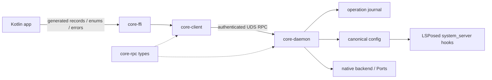

# Core architecture

Current implementation on `dev-2.x`, app/core RPC version 12. The backend
control-v2 / telemetry-v1 wire is a separate boundary. This document describes
the implemented ownership and execution contract.

## Owners and boundaries

| Owner | State and responsibilities |
|---|---|
| Core daemon | Durable canonical config, command plans and receipts, boot selection, backend delivery, Ports, root observations, debug leases and logcat recording |
| App process | Editor drafts, queued user intent, local preferences, navigation, app-context measurements and presentation |
| LSPosed hook in system_server | Direct canonical JSON reads, Java hooks and their telemetry |
| Native backend | Delivered policy, installed hooks and backend-specific runtime evidence |

Core is the ordinary privileged writer. It accepts fixed commands and bounded
probes, never arbitrary shell text. The APK has no root executable or `su` path.
Backend packages contain artifacts only; `activator` is a core-side library.

The dependency path is `Kotlin → core-ffi → core-client → core-rpc`. Generated
UniFFI records, enums and errors carry config, edits, commands, publications,
refusals, receipts, leases, diagnostics and recording sessions. There is no JSON
request/reply facade at this boundary. The APK does not link the daemon, activator
or root probes. JSON remains a storage/import/export format, diagnostic payload
content, private typed Rust probe inputs and tarpc's internal UDS serialization.

## Connection and app replica

One process-retained `CoreSession` owns one lazily connected, multiplexed tarpc
channel. Each new channel passes the version handshake. `core-client` fences
transport failures by connection generation; an older failed channel cannot
invalidate its replacement. It has no second watch-state mirror.

Kotlin long-polls `state_since(epoch, revision)` and feeds one publication reducer.
Connection generation, request success/failure ordering, epoch and publication
revision determine whether a response is current. Late replies cannot restore an
old epoch or clear a newer failure. Disconnect withdraws current evidence while
last-good display data may remain. Reconnection retries reads, never mutations.

Config revision changes with canonical state; publication revision also covers
observations and progress. Observations therefore do not create editor conflicts.
Heavy root snapshots provide explicit inventory/counters/forensic details; config,
boot selection and routing come from the shared typed publication.

Root and config inputs join only after the app coordinator accepted at least the
root snapshot's core sequence, with matching core epoch and config revision. A
new epoch reusing a config revision cannot silently borrow old config provenance.

The production socket is in the release app's user-0 device-encrypted data dir.
DAC, its SELinux label and peer credentials restrict access to root and the
current directory owner. See [IPC authorization](notes/core-2.0-ipc-auth.md).

## Commands, admission and execution

The app coordinator owns intent, drafts and feedback. It obtains a durable
core-issued operation ID, then submits one `CoreCommand` with a base config
revision. Ordinary field edits form one flat `Batch`, bounded to 4096 edits.
Import, optional legacy cleanup, SuperKey changes and FullReset are compound
commands executed by core. Kotlin does not sequence privileged phases.

Core checks field write sets against the actual current revision. Unrelated
stale edits can merge; overlapping edits refuse atomically. Explicit import uses
`Replace`; `RepairActivation` reapplies the durable config. Schema, size, codec
round-trip and capacity validation precede normal persistence. Credential updates
remain admissible when activation capacity fails; their Native phase reports it.

CommandEngine owns the authoritative ConfigStore, a bounded 16-message mailbox,
typed command messages and the single writer's lifecycle. Internal boot/lease work
uses completion waiters; RPC command submission uses an admission waiter. The
writer validates schema, conflicts, capacity and identity before syncing the first
phase intent. Only then does RPC receive Accepted, before the effect starts.
Execution continues independently of socket or waiter lifetime. Blocking children and durable writes do not hold the readable
state mutex. Publications and receipt queries remain available during a slow
operation. The actual admitted revision and write set are journaled before
Persist. Persist gates delivery; a known Native failure still permits independent
Ports work. Each phase has its own Confirmed/FailedKnown/Unknown/NotAttempted
outcome, and confirmed persistence remains saved after delivery failure.

## Durability and recovery

Canonical replacement applies required ownership, mode and label before rename,
then fsyncs the containing directory. A failure after rename is Unknown, never a
claim that no write occurred. The private journal records commands, phase intent,
actual commit revisions, write sets and exact Native dispatch evidence. Secrets
and secret-derived verifiers never enter it. Journal schema 2 reads/migrates
schema 1; blank, malformed or unsupported present journals refuse mutations.

Same-ID duplicate commands query the retained result; different commands refuse.
SuperKey submission always refuses reuse because comparing the secret would
require retaining secret material: recover it with `get_operation`. IDs are
allocated durably and monotonically. Retention keeps 64 terminal receipts plus
active/restoration records; an expiry high-water mark replaces unbounded
tombstones. Expiring an Unknown receipt preserves its held resource in a compact
aggregate, including the pending Persist evidence needed for readback. Thus
receipt retention cannot remove uncertainty or permanently prevent repair.
Expired or never-issued IDs cannot dispatch new work.

An unfinished crash phase receives one evidence reconciliation, without replay.
Persist readback can establish the actual committed revision. Exact recorded
Zygisk wire and recipient can establish publication; kernel telemetry or firewall
chain presence alone cannot prove an intended apply. Terminal Unknown receipts
stay immutable. Explicit repair may supersede held resource phases only where
new delivery is confirmed; a failed or Unknown phase keeps its own resource held.

Held Persist uncertainty blocks new capture leases and credential config edits
until explicit repair reads back the actual canonical state. Baseline restoration
also adopts fresh durable state before choosing the user's logging intent, so a
landed rename cannot be overwritten from an older in-memory config.

## Capture and measurement

Core-owned expiring leases cover forensic capture and logcat. The journal keeps
the previous user logging intent and a separate restoration obligation, including
its operation ID. Deleting, acknowledging or replacing a recording cannot erase
that obligation. Forensic captures renew while alive; expired leases are retired
by the writer's maintenance loop. All orphan leases are released at daemon restart.
An uncertain restoration remains visible and is not automatically replayed.
A known failed restoration can use a fresh operation after an explicit release;
superseding uncertainty still requires restoring the actual baseline target.

App capture actions have process lifetime and release leases in a noncancellable
finalizer. A cancelled UI waiter does not stop recording or lose its lifecycle.
FullReset checks core leases and actual recorder activity before side effects.

Desired config, delivery receipts and measured app behavior are distinct facts.
A measurement under unconfirmed delivery can show observed results, but cannot
establish that the desired revision was applied or produce current success.

## Observations and resource bounds

Core listens for link, IPv4/IPv6 route and rule notifications. Bursts debounce
for 250 ms; two delayed samples catch late framework registration. Lost events
withdraw current evidence and trigger bounded resync; failed sources reopen.
Framework classification and main-app UID membership share one bounded
`dumpsys connectivity` read. Network IDs distinguish VPN replacement on `tun0`;
unmanaged membership retains separate provenance. UID ownership is checked every
five seconds, and full framework fallback runs every 30 seconds while idle.
Unchanged evidence does not advance routing generation. Runtime backend refresh
updates liveness/freshness without overwriting boot selection or delivery facts.

Diagnostics admit at most two concurrent collections, 32 probes per request and
four probe workers. Capture is bounded to 64 MiB per request and 32 MiB per probe;
the whole collection has a 200-second budget. Large outputs use unique export
directories. Fixed external commands have output
and wall-time bounds; process-group cleanup also handles inherited output pipes.
See [limits](limits.md) for the other transport, target and recording limits.

KPM telemetry is authenticated in the parent, then supplied as a bounded typed
observation to isolated snapshot/counter children over stdin. A session-only key
stays in core memory and works for diagnostics without being copied into a child,
an argument, environment, journal or temporary file. Standalone CLI observations
still authenticate with their own available credentials.

## Process and storage lifecycle

Permanent flock inodes protect both canonical and journal resources before load,
boot or bind. A separate socket lock prevents live socket replacement. The service
entry supervises its worker with bounded restart backoff; duplicate ownership
exits rather than creating a restart fight. Module disable/removal stops restart.
A corrupt durable state exposes `startup_error` and read-only observations/probes
while refusing mutation; it is never silently replaced with defaults.

Native selection remains strict and fixed per boot: zero candidates, one selected
candidate, or Conflict. Save and Repair deliver to that selection; KPM credentials
have an explicit authentication path. Ports resolves the complete package/UID map
before touching firewall rules, preserving old rules on resolution failure. IPv4
and IPv6 outcomes remain independent.

See [storage](storage.md), [state](state.md) and
[module lifecycle](notes/core-2.0-module-lifecycle.md) for paths and boot details.
RPC skew fails the handshake; update APK and core together for version 12.
Host tests/builds do not establish Android DAC/SELinux behavior, root-manager boot,
ROM parsing or hook coverage; these still require device validation.

## Review hardening and migration boundary

Canonical file IO is separated from the pure schema-1 adapter in
`crates/core-daemon/src/config_file/codec.rs`. Present invalid fields, overflowing
versions and blank files fail startup without replacing their contents. Schema 1
is still the live LSPosed interchange contract, so it is retained deliberately.
The typed engine does not interpret polymorphic disk roles.

App import adapters live together in `migration/`: pre-1.0 component lists and
observer UID mapping, and strict schema-1 JSON import for 1.x/current backups.
Both produce the current typed model and use normal core validation, atomic Persist
and journaled cleanup. No old activator or runtime write path is restored.
Unresolved UIDs or malformed source lines prevent automatic source cleanup;
explicit discard remains a separate user action. See [migration](migration.md).

Recovery permissions are projected through typed UniFFI from the shared
`core-rpc::recovery` policy used by admission. A held operation does not block
explicit Repair, credential recovery, cleanup or reset indiscriminately. Persist
uncertainty still prevents credential changes, captures prevent reset, and core
revalidates every command. Startup fault text is retained in the app state and
shown in the blocked-state dialog. Recovery actions are local typed FFI projections over the RPC state.

File-producing probes run in private root-owned staging. Completed files are copied
through exclusive, no-follow descriptor-relative destinations; permissions, owner
and Android label are applied through the same open descriptor. App-controlled
path replacement cannot redirect writes or metadata changes. The same publication
primitive serves large text probes and logcat. Staging is removed on completion,
timeout/error, and after a daemon restart under the exclusive state locks.

Automatic boot repair uses the same recovery-policy module, but deliberately has
a stricter rule than explicit user repair. The writer checks the current journal,
including retained aggregate holds, before effects: Persist uncertainty blocks all
boot delivery; Native uncertainty or Secret uncertainty blocks Native; Ports
uncertainty blocks Ports. Independent resources may still receive a fresh boot
repair. Cleanup alone does not block Native/Ports. Boot never replays the old
operation or reconciles a dependent held Persist implicitly. The original Unknown
receipts and their holds remain unchanged. This includes the delayed Ports pass.

Runtime journal failure is separate from terminal effect uncertainty. RPC v12
publishes `storage_fault` and blocks mutations until restart/reconciliation. If
terminal settlement could not be synced, `get_operation` retains an unsettled
record (`settled = None`), not a fabricated terminal Unknown; no operation is
claimed to be running while storage is faulted. If settlement synced but a later
retention/repair-metadata write failed, the durable terminal receipt is preserved.
Restart reconciles only unfinished intent from disk; an already durable terminal
receipt remains immutable. The app exposes the storage fault in its blocked-state
feedback and disables recovery mutations while the storage fault persists.

Lease registration reserves a restoration obligation before enabling logging.
A failed acquire leaves a bounded pending reservation, never an active-success
claim: renewal must ensure logging and a confirmed activation receipt before
returning success. Known failures may be retried; held Persist/Native/Secret
resources needed for logging refuse acquire rather than replay uncertain effects.
Live deadlines use `Instant`; the journal wall-clock expiry is display metadata.
Restart discards both forensic and logcat leases from the old daemon instance,
while retaining the original baseline/restoration receipt for safe maintenance.

The app keeps an admitted, unsettled action pending and observes the process-owned
session before querying its terminal receipt. It does not classify normal progress
as ApplicationUnknown and never re-submits an admitted command. Disconnect or a
storage fault still enters explicit uncertainty/recovery. Commands queued behind
an active writer have not yet been admitted: the mailbox stays bounded and full
queues return Busy. Queue wait and ID allocation can still wait behind a slow
writer; bounding their deadlines is remaining B3 work, not solved by early Accepted.
ConfigStore snapshots still use short mutex sections and working clones around IO;
this change does not claim elimination of every clone/converter or a transport rewrite.

KPM observations and delivery share a process-local per-lock-path gate before the
external flock. Reads fail busy rather than blocking; delivery/load may wait up to
10 seconds for a local observation before first dispatch. An external process's
flock still refuses immediately. This prevents core's own read from spuriously
failing its delivery; it never retries an already-dispatched or uncertain effect.
